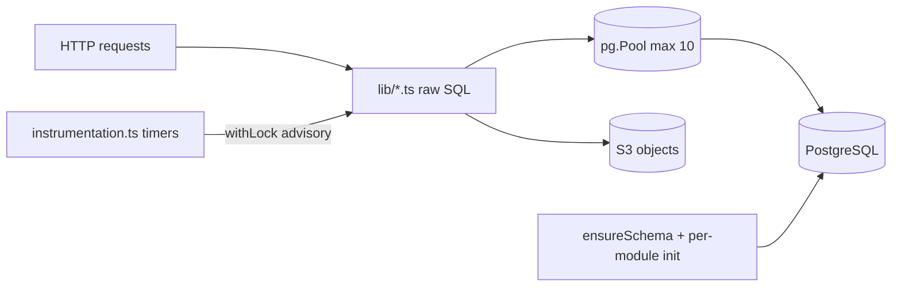

# Database Reliability, Integrity & Performance Audit — Kzoo Makers website

**Repo:** `kzoomakers-web` · **Branch:** `ux/audit-p0-p1` · **Method:** static review of `web/lib/*.ts`, `web/instrumentation.ts`, `fly.toml`, `docker-compose.yml`. No database was reachable, so **no `EXPLAIN` plans, row counts, `pg_stat_*` data or backup settings were inspected.** Everything below is from code; performance claims are static predictions, labelled as such.

Status tags: ✅ **Fixed in this branch** (see "Changes made alongside this audit") · ⚠ open.

---

## Executive Summary

The data layer is **better than its structure suggests.** Money is not stored (no payments), uniqueness is mostly enforced by the database (`UNIQUE`, composite PKs, `ON CONFLICT`), the highest-contention workflow (tour booking) uses a transaction plus an advisory lock correctly, the mail queue uses `FOR UPDATE SKIP LOCKED`, the admin-count invariant in `users.ts` is a single conditional statement, and the HTTP log is partitioned with bounded queries.

The real risks are operational and structural:

1. **No pool `error` handler (confirmed, was Critical).** A database restart or failover drops idle connections; `pg.Pool` emits `error` and, with no listener, Node terminates the process. ✅ Fixed.
2. **No versioned migrations; DDL is spread across ~10 lazy `ensure` blocks** (`db.ts`, `mail.ts`, `tours.ts`, `chores.ts`, `ntfy.ts`, `links.ts`, `contact.ts`, `api-keys.ts`, `httplog.ts`, …). The earlier architecture audit named two; there are about ten. No schema version, no rollback, no way to know what a given database looks like. ⚠
3. **Scheduled work was not safe beyond one machine** (duplicate emails/reminders). ✅ Locked; campaign delivery now takes a per-campaign advisory lock.
4. **Check-then-act admin guards in `profiles.ts`** (delete/disable) can be raced below `MIN_ADMINS`. ⚠
5. **Unbounded growth** of `audit`, `page_revisions`, `tour_events`, `mail_clicks`, `mail_sends`, `contact_messages`; binary payloads (`bytea`) live in the primary database, which dominates backup size. ⚠
6. **Backups / PITR / restore tests / replication: unassessable** from the repo (`.env.example` suggests Aiven-managed Postgres; that service's backup settings are not visible). Marked *unverified*, not *absent*.

Not assessed: query plans, table sizes, index usage, bloat, autovacuum, replication lag, actual Postgres version, role privileges, TLS enforcement on the live server.

---

## Database Architecture Overview

| Item | Observed |
|---|---|
| Engine | PostgreSQL (`pg` driver, no ORM). Managed host implied by `.env.example` (Aiven), TLS via `DATABASE_CA`. Local: `docker-compose.yml` Postgres. Version not verifiable. |
| Other stores | S3-compatible object storage (uploads, not transactional with the DB). No Redis. In-process memory caches only (`ntfy` cfg 30 s, debug-stream 5 s). |
| Access | Raw parameterised SQL in every `lib/*.ts`; `store.ts` is not "all queries" (README corrected). One shared `conn()` now lives in `db.ts` (was 17 copies). |
| Pool | Single `pg.Pool` cached on `globalThis`, keyed by config. Previously defaults only (max 10, no timeouts). Now: idle timeout 30 s, `statement_timeout` 60 s, `idle_in_transaction_session_timeout` 120 s, error listener. |
| Schema source of truth | Imperative `CREATE … IF NOT EXISTS` / `ALTER … ADD COLUMN IF NOT EXISTS` run on boot (`ensureSchema` under `pg_advisory_lock(7351902)`) plus per-module lazy inits. |
| Writers | Web requests; in-process timers (`instrumentation.ts`): mail tick, tour reminders, stale walk-ups; fire-and-forget campaign worker (`mail.ts work()`); HTTP-log buffer flush. |
| Cross-store consistency | Uploaded files (S3) vs rows (`media`, member photos): no transaction; orphaned objects possible. Signed PDFs/IDs are in Postgres `bytea`, encrypted. |

---

## Reliability Scorecard

Scale: 1 = actively dangerous, 5 = adequate with known gaps, 8–10 = mature. "Unassessed" = no evidence available.

| Dimension | Score | Evidence | Principal Risk |
|---|---|---|---|
| Schema Integrity | 6 | `NOT NULL` defaults, `CHECK` on status/level enums, PKs everywhere | `status` columns in several tables are unconstrained text; dates stored as text in tours |
| Referential Integrity | 7 | FKs with deliberate `CASCADE`/`SET NULL` throughout | `chore_log.chore_id`, `chore_achievements.chore_id` have no `ON DELETE` (restrict), `mail_forms.lists int[]`/`campaign.list_ids int[]` are unenforced arrays |
| Indexing Strategy | 5 (static) | Targeted indexes exist; several FK columns lack them | See DB-007; unverified without plans |
| Query Efficiency | 6 (static) | Mostly `LIMIT`ed; leading-wildcard `ILIKE` on unindexed columns | CRM directory search, correlated count subqueries |
| Transaction Correctness | 7 | Tours, CRM profile save use real transactions | Multi-statement admin ops (`profiles.ts`) are not transactional |
| Concurrency Safety | 6 | Advisory lock on booking, `SKIP LOCKED` on queue, `ON CONFLICT` | DB-003 write skew; signup capacity is waitlist-by-rank (safe by design) |
| Lock Management | 6 | Short transactions; advisory locks released in `finally` | Campaign lock holds a pool connection for the whole send |
| Migration Safety | 3 | Additive-only, idempotent, advisory-locked | No versions/rollback; boot-time data `UPDATE`s; DDL in many places |
| Data Consistency | 6 | Audit log + revisions; atomic upserts | S3↔DB drift; unbounded derived counters (`mail_campaigns.sent/failed`) |
| Connection Management | 6 (was 3) | Now has timeouts + error handler | Pool max 10 with long-lived campaign lock; no failover testing |
| Backup & Recoverability | Unassessed | Managed service settings not visible | Verify PITR + restore drill; `PII_CRYPTO_SECRET` loss = unreadable IDs/PDFs |
| Database Observability | 6 | `pgstats` admin page (`pg_stat_activity`, statements), HTTP log, debug streams | No alerting; no slow-query log evidence |
| Operational Reliability | 5 | Single machine, restart policy, health check `/login` | Health check does not prove DB reachability; no scaling story beyond locks |

---

## Prioritized Findings

| ID | Severity | Category | Location | Defect / Risk | Impact | Effort |
|---|---|---|---|---|---|---|
| DB-001 | ✅ Critical→Fixed | Connection mgmt | `lib/db.ts poolFor` | No `pool.on("error")`; idle-connection error crashes process | Whole site down on any DB restart/failover until Fly restarts it (and `restart.retries = 10`) | Small |
| DB-002 | ✅ High→Fixed | Concurrency | `instrumentation.ts`, `mail.ts work()` | Timers/campaign worker had no cross-process guard | Duplicate campaign emails, duplicate reminder events if >1 machine (or overlapping deploy) | Small |
| DB-003 | High | Concurrency | `profiles.ts` delete (~L78–90) and `setDisabled` (~L115–123) | Check-then-act on `MIN_ADMINS` | Two concurrent requests each see ≥ MIN+1 admins and both succeed → fewer than 3 active admins | Small |
| DB-004 | High | Migrations | `db.ts migrate()` + ~9 module inits | No version table, no rollback, DDL scattered; ~100 statements per boot, some take locks | Cannot reproduce/verify schema; a failed partial init leaves a half-built module until restart | Large |
| DB-005 | Medium | Migrations | `db.ts` L43,59,107,121 | Data-mutating `UPDATE`s run on **every boot** (e.g. `approval='pending' WHERE verified_at IS NULL AND approval='approved'`) | After a restore or a new insert path that skips `verified_at`, restart silently demotes members to pending | Small |
| DB-006 | Medium | Data lifecycle | `audit`, `page_revisions`, `tour_events`, `mail_clicks`, `mail_sends`, `contact_messages`, `notifications` | No retention (contrast `rate_hits`, `login_fails`, `link_clicks`, `ntfy_*`, `debug_log` which are pruned) | Slow growth; `audit` JSONB snapshots and revisions dominate storage; offset pagination degrades | Medium |
| DB-007 | Medium | Indexing | see matrix | FK columns without supporting indexes | Cascades (delete a member/campaign/doc) seq-scan child tables; list joins slower as data grows | Small |
| DB-008 | Medium | Storage | `sign_docs.pdf/source`, `member_ids.data`, `financials.data`, `sign_templates.source` (`bytea`) | Binary blobs in the OLTP database | Large backups/restores, TOAST bloat, replication volume; `SELECT *`-style reads pull blobs | Medium |
| DB-009 | Medium | Query | `crm.ts` ~L119–121 | `ILIKE '%x%'` across 6 columns + 2 `EXISTS` on non-trigram columns | Seq scans on directory search; only `site_users(name,email)` have trigram indexes | Small |
| DB-010 | Medium | Backup | not visible | Backup/PITR/restore evidence absent from repo | **Unverified**, not absent. Also `PII_CRYPTO_SECRET` is a single point of loss | Small (process) |
| DB-011 | Low | Integrity | `email text UNIQUE` | Uniqueness is case-sensitive; relies on every writer lowercasing (`readers.ts`, `approvals.ts` do) | A future insert path that forgets `toLowerCase()` creates duplicate accounts | Small |
| DB-012 | Low | Transactions | `crm.ts` ROLLBACK | `ROLLBACK` without `.catch` masked the original error on a dead connection | Misleading error text | ✅ Fixed |
| DB-013 | Low | Consistency | `profiles.ts setDisabled` | Four statements (update, token delete, topic lock, audit) not in one transaction | Partial disable if the process dies mid-way (comment says re-enable retries) | Small |
| DB-014 | Low | Health | `fly.toml` check `/login` | Health check does not query the database | Machine reports healthy while DB is unreachable | Small |

---

## Detailed Findings (substantive)

### DB-001 — Pool without error handler *(Confirmed, fixed)*
- **Evidence:** `poolFor` returned `new Pool({...connectionTimeoutMillis: 5000})`; no `pool.on("error")` anywhere (`grep "pool.on"` → none).
- **Scenario:** Aiven maintenance/failover closes idle sockets → `pg` emits `error` on the pool → uncaught `'error'` event → process exit.
- **Fix applied:** listener that logs; idle timeout 30 s; `statement_timeout` 60 s; `idle_in_transaction_session_timeout` 120 s.
- **Verify:** restart the database (or `pg_terminate_backend` on idle sessions in a test DB) and confirm the app stays up. **Regression risk:** a legitimately >60 s statement now cancels. Long reports (`httplog`) set their own 25 s; none known >60 s.
- **Acceptance:** killing idle backends does not restart the container.

### DB-002 — No cross-process guard on scheduled work *(Confirmed, fixed)*
- `tick()` (mail queue + scheduled campaigns), `checkReminders()`, `checkStale()` ran from `setInterval` in every process; `work(campaignId)` used an in-memory `Set`. Two machines (or a rolling deploy overlap) would each deliver the same `pending` `mail_sends` rows.
- **Fix applied:** `withLock(id, fn)` in `db.ts` (`pg_try_advisory_lock` on a dedicated connection, released in `finally`; session locks are released automatically if the process dies). Jobs use 7351911–13; campaign delivery uses `8_000_000 + campaignId`.
- **Residual:** `deliver` then `UPDATE mail_sends SET status='sent'` is not atomic — a crash between them re-sends one email on resume (at-least-once). Acceptable; to fix, mark `sending` first or send with an idempotency header.
- **Trade-off:** a running campaign holds one of 10 pool connections for its duration.

### DB-003 — Admin-floor write skew *(Confirmed code path; race Requires Validation)*
- `users.ts` does this correctly (one conditional `UPDATE … WHERE (SELECT count…) > MIN`). `profiles.ts` (delete member, disable member) does `SELECT count(*)` then acts in a separate statement.
- **Scenario:** 4 active admins; two admins simultaneously disable different admins. Both read count 4 (> 3), both proceed → 2 remain.
- **Fix:** run the check and write in one transaction with `SELECT … FROM user_perms WHERE section='admin' AND level='write' FOR UPDATE` (serialises competing changes), or `pg_advisory_xact_lock(7351920)` at the top of each admin-count-sensitive function.
- **Verify:** integration test firing both calls with `Promise.all`; expect one to throw. **Effort:** Small. **Acceptance:** ≥ `MIN_ADMINS` active admins after N concurrent runs.

### DB-004 — Schema management
- Boot runs the full `migrate()` for every process under an advisory lock; modules additionally create their own tables lazily (`tours`, `chores`, `ntfy`, `links`, `contact`, `api-keys`, `mail`, `httplog`). Only `httplog` guards against redundant `ALTER`/`CREATE INDEX` (it notes they take locks even when no-ops).
- **Risks:** no ordering guarantee between module inits and `migrate()` (FKs to `site_users` assume it ran first — true today because every `conn()` awaits `d.ready`); no visibility of applied state; a rename/type change cannot be expressed.
- **Safer sequence:** (1) add `schema_migrations(version int primary key, applied_at)`; (2) snapshot current schema as migration `0001` (`pg_dump --schema-only` from production, idempotent); (3) move each module's DDL into numbered files; (4) run in Fly `release_command` (`node scripts/migrate.mjs`) *before* new machines start; (5) keep the app boot path read-only. Use `CREATE INDEX CONCURRENTLY` (outside a transaction) for tables >100k rows; add constraints `NOT VALID` then `VALIDATE`.
- **Effort:** Large. **Regression risk:** Medium (init order). **Acceptance:** empty DB + migrations == production schema (`pg_dump -s` diff empty).

### DB-005 — Boot-time data updates
- Examples: `UPDATE site_users SET approval='pending' WHERE verified_at IS NULL AND approval='approved'` (comment: "never-verified sign-ups must not skip the queue"), name split backfill, `UPDATE comments … WHERE hidden`. Idempotent, but they are *data policy applied at every start*. Currently safe because `approvals.ts` always sets `verified_at` when approving.
- **Fix:** run once in a numbered migration (DB-004), or replace the first with a `CHECK (approval <> 'approved' OR verified_at IS NOT NULL)` added `NOT VALID` then `VALIDATE` after confirming zero violating rows.

### DB-006 / DB-008 — Growth and blobs
- Only `debug_log`, `rate_hits`, `login_fails`, `link_clicks`, `ntfy_*`, `login_tokens` are pruned. `audit.data` and `page_revisions.data` store full JSON snapshots per edit; `mail_sends` holds one row per recipient per campaign forever.
- **Recommendation:** define retention (e.g. `audit` rows without `data` > 2 years, `mail_clicks` > 1 year, `tour_events` > 1 year); keep revision snapshots capped per slug (keep latest 50). Move PDFs/IDs to encrypted S3 objects with the key stored in the row — only if backup size becomes an issue (needs an S3-vs-DB consistency story, so not free).
- **Verify:** `SELECT relname, pg_size_pretty(pg_total_relation_size(oid)) FROM pg_class WHERE relkind='r' ORDER BY pg_total_relation_size(oid) DESC LIMIT 15;` (read-only).

### DB-007 — Candidate indexes (static; confirm with `pg_stat_user_tables.seq_scan` / plans before adding)
See matrix. Write cost is negligible at this scale.

### DB-009 — Directory search
`crm.ts` search ORs `first_name`, `bio`, skill names/notes and field values with leading-wildcard `ILIKE`. At makerspace scale (hundreds of members) a seq scan is cheap; this becomes a concern only past ~50k rows. Extend the existing optional `pg_trgm` block to `bio` if measured slow.

### DB-010 — Recovery (operational, unverified)
Needs confirmation outside the repo: provider backup schedule and retention, PITR window, a timed restore drill into a scratch instance, RPO/RTO written down, and **offline escrow of `PII_CRYPTO_SECRET`** (losing it makes `member_ids` and signed PDFs permanently unreadable even with perfect backups).

---

## Schema Integrity & Constraint Findings

| Table | Weak constraint | Possible anomaly | Change | Migration risk |
|---|---|---|---|---|
| `site_users.email` | `UNIQUE` on raw text | `A@x.org` and `a@x.org` as two accounts if a writer skips lowercasing | `CREATE UNIQUE INDEX CONCURRENTLY … (lower(email))` after checking for dupes | Low (check dupes first) |
| `comments.status`, `posts.status`, `review_submissions.status`, `class_proposals.status`, `mail_subscribers.status`, `mail_campaigns.status`, `sign_signers.role` | Free text | Typo'd status never matches any query filter | `CHECK (status IN (…))` added `NOT VALID`, then `VALIDATE` | Low |
| `mail_campaigns.list_ids int[]`, `mail_forms.lists int[]` | Array of ids, no FK | Deleted list leaves dangling id; harmless to queries today | Leave, or normalise to a join table if lists get deleted often | Medium |
| `chore_log.chore_id`, `chore_achievements.chore_id` | FK with no `ON DELETE` | Deleting a chore with history fails (restrictive) — may be intentional | Confirm intent; document | Low |
| `tour_blocks.date`, `.start_time`, `.end_time` (text) | Text dates | Invalid strings accepted; sorting works only because ISO | Keep (deliberate, wall-clock in `TZ`); add `CHECK (date ~ '^\d{4}-\d\d-\d\d$')` | Low |
| `classes.price`, `class_proposals.price` (text) | Free text | No arithmetic done on it (display only) — not a money-handling defect | None | — |
| `classes.capacity` | no `CHECK (capacity >= 0)` | Negative capacity treated as full | `CHECK (capacity >= 0)` | Low |
| `sign_docs.status` | `CHECK` present | — | — | — |
| `class_signups` | PK `(class_id, user_id)` | — (duplicates prevented, waitlist by rank) | — | — |

## Indexing & Query Optimization Matrix

All entries are **static analysis**, no plans available.

| Query / location | Access pattern | Current support | Problem | Recommendation | Evidence |
|---|---|---|---|---|---|
| `sign_signers WHERE doc_id=…` (`sign.ts`, FK cascade) | join/lookup by doc | none (only `token` unique) | Every doc load and cascade delete scans signers | `CREATE INDEX CONCURRENTLY ON sign_signers (doc_id)` | `db.ts` L146–148 |
| `mail_memberships WHERE list_id=…` (`AUDIENCE`, `getLists`) | audience by list | PK `(subscriber_id, list_id)` leads with subscriber | List→subscribers scans | index `(list_id, subscriber_id)` | `mail.ts init` |
| `mail_sends WHERE subscriber_id=…` / cascade | per-subscriber history, delete cascade | none | cascade from subscriber delete scans all sends | index `(subscriber_id)` | `mail.ts init` |
| `mail_clicks WHERE campaign_id=…` | click stats | none | scan grows with total clicks | index `(campaign_id)` | `mail.ts init` |
| `comments WHERE user_id`, `comment_likes WHERE user_id`, `class_signups WHERE user_id`, `member_skills WHERE skill_id`, `tool_auths WHERE tool_id`, `sign_docs WHERE user_id/bucket_id` | FK cascades / "my …" lists | PK leading column is the other side | member deletion cascades seq-scan | add on demand if `seq_scan` is high | `db.ts` |
| `audit WHERE action LIKE 'x.%' AND data IS NOT NULL ORDER BY id DESC LIMIT 100` | recent revisions by family | PK scan backward | Fine while the family is frequent; may scan far for rare families | partial index `(id DESC) WHERE data IS NOT NULL` if slow | `store.ts` L117 |
| `audit … LIMIT 100 OFFSET n` with `count(*)` + `date_trunc` aggregate | admin audit browser | none beyond PK | three queries per page; offset grows | keyset on `id`; cap date range | `store.ts` L197–199 |
| `crm.ts` directory ILIKE | search | trigram on name/email only | see DB-009 | trigram `bio` if slow | `crm.ts` L119 |
| `ntfy.ts listTopics2` correlated `count(*)` per topic | admin list | `ntfy_messages_topic` | N correlated subqueries, fine for few topics | leave | `ntfy.ts` L164 |
| `getLists` | `count(*) FILTER … GROUP BY l.id` over join | PK | full join of memberships×subscribers each load | cache or index above | `mail.ts` |
| `SELECT *` on `contact_messages`, `tour_requests`, `classes`, `mail_campaigns` | by id | PK | `mail_campaigns.design` jsonb returned where unneeded; `sign_docs` queries avoid `pdf` already | fine; keep blobs out of list queries | various |

## Transaction & Concurrency Risk Matrix

| Workflow | Current behaviour | Failure scenario | Severity | Control |
|---|---|---|---|---|
| Tour booking (`tours.ts` L237) | `BEGIN` + `pg_advisory_xact_lock(7001, block)` + capacity & duplicate checks + insert | none found — correct | — | — |
| Tour block delete (`tours.ts` L111) | `FOR UPDATE` on blocks inside tx | none found | — | — |
| Tour request accept (`tours.ts` L357) | `SELECT … FOR UPDATE` | none found | — | — |
| Class sign-up (`crm.ts` L273) | single `INSERT … ON CONFLICT DO NOTHING`; capacity decided by rank at read time | none: over-subscription becomes waitlist | — | — |
| Member profile save (`crm.ts` L82) | one transaction (delete+insert fields/skills) | none; skills upsert uses `ON CONFLICT` on the lower() index | — | — |
| Sign-up / login (`readers.ts`) | `ON CONFLICT (email) DO UPDATE` | atomic | — | — |
| Admin floor in `users.ts` | conditional `UPDATE` | none | — | — |
| Admin floor in `profiles.ts` delete/disable | read count, then write | DB-003 write skew | High | tx + lock |
| Mail queue flush | `UPDATE … WHERE id IN (… FOR UPDATE SKIP LOCKED) RETURNING` (visibility lease 10 min) | crash mid-send → retried after lease (at-least-once) | Low | accept |
| Campaign delivery | per-recipient send then status update | crash between → one duplicate | Low | accept / send-id header |
| Campaign start `begin()` | insert sends, count, update status — three statements | crash between insert and status update: next tick (status still `scheduled`) inserts the audience **again** → duplicate `mail_sends` rows → double email | **Medium** | wrap in transaction or add `UNIQUE (campaign_id, subscriber_id)` + `ON CONFLICT DO NOTHING` (needs duplicate check first) |
| Counters `mail_campaigns.sent = sent + 1` | atomic increments | none | — | — |
| Page save (`store.ts`) | upsert + revision + audit as separate statements | crash between → page saved without revision row | Low | single tx |

> Note the **`begin()`** row: confirmed code path (no unique key on `mail_sends(campaign_id, subscriber_id)`), crash window is narrow; listed here rather than in the main table as DB-015 (Medium) for tracking.

## Migration Safety Assessment

| Migration | Risk | Scenario | Severity | Safer approach |
|---|---|---|---|---|
| `ensureSchema` on every boot | Lock acquisition | `ALTER TABLE … ADD COLUMN IF NOT EXISTS` takes `ACCESS EXCLUSIVE` briefly even if no-op; a long query blocks it, and then blocks everything behind it | Medium | Check `information_schema` first (as `httplog.ts` does) or move to release-time migration |
| `site_users` ADD COLUMN … `NOT NULL DEFAULT ''` (×20) | Table rewrite pre-PG11 | PG ≥ 11 is metadata-only; version unverified | Low | confirm PG ≥ 11 |
| `UPDATE pages … created_at` backfill | one big statement | small table, fine | Low | — |
| `welcomed_at` `DO $$` block | one-shot backfill gated on column absence | correct, runs once | Low | — |
| `ADD COLUMN approval … CHECK` | constraint added on existing rows with default | fine | Low | — |
| Locked pages `INSERT … ON CONFLICT DO UPDATE` each boot | overwrites DB with files | by design; manual DB edits to locked slugs are lost at restart | Low | document |
| Future type changes/renames | not expressible | would need hand-written `ALTER` inside init code | Medium | DB-004 |

## Data Consistency & Invariants

| Invariant | Protection |
|---|---|
| One account per email | `UNIQUE` (case-dependent on writers) |
| Tour slot never over capacity | transaction + advisory lock |
| ≥ `MIN_ADMINS` active admins | conditional `UPDATE` in `users.ts`; **application check-then-act** in `profiles.ts` |
| Founding admin immutable | `user_perms.locked` + application checks |
| Approved ⇒ verified | application only (DB-005) |
| Waiver version immutable | convention (no UPDATE paths seen); no trigger |
| Subscriber unique per email | `UNIQUE` |
| Campaign recipient unique | **not enforced** |
| Signed PDF integrity | `sha` column + AES-GCM |
| Uploaded file ↔ row | none (S3 separate) |
| Audit completeness | application convention (`logAudit`), not a trigger — a direct SQL edit leaves no trace |
| Money | none stored |

## Performance & Capacity Hotspots (static predictions, no measurements)

| Rank | Operation | Location | Concern | Action |
|---|---|---|---|---|
| 1 | Public page render (`force-dynamic`) | `app/[[...path]]`, `store.ts` | One Postgres read per view, uncached | ISR / `revalidateTag` on publish |
| 2 | `begin()` audience insert + `work()` loop | `mail.ts` | Sequential per-recipient SMTP/API calls hold a pool connection + advisory lock for the whole campaign; `perMinute` throttling extends it | Fine at current list size; use batching if lists grow large |
| 3 | HTTP log writes | `httplog.ts` | Every request buffered → inserts; partitioned, bounded | Monitor partition creation |
| 4 | Audit browser | `store.ts` L197 | 3 queries/page incl. aggregate over full filtered range | Keyset + date cap |
| 5 | `getLists`/subscriber counts | `mail.ts` | Join+aggregate per page load | Index (DB-007) |
| 6 | Boot DDL | `db.ts` | ~100 statements per start, lock queueing | DB-004 |

## Reliability & Recovery Gaps

- **Connection exhaustion:** single machine × pool 10 against a managed Postgres is fine; scaling out multiplies by N — check the plan's connection cap. Long campaign locks hold 1 connection each. *Pool saturation is not observable* (no metric exported; `pgstats` page shows server-side `pg_stat_activity` only).
- **Long transactions:** none found beyond tour/CRM (short). Now bounded by `idle_in_transaction_session_timeout`.
- **Deadlocks:** lock ordering not an issue in observed code (single-row/advisory locks).
- **Replication, storage growth, backups, restore, failover, DR docs:** *unverified* (provider-side). Failover reconnect is now survivable (DB-001) but untested.
- **Health check:** `/login` doesn't touch the DB (DB-014).

## Recommended Improvements (with trade-offs)

1. Versioned migrations in `release_command` (biggest evolution win; one-time effort, init-order risk).
2. Transaction + advisory lock in `profiles.ts` admin-floor paths (tiny, no downside).
3. `UNIQUE (campaign_id, subscriber_id)` on `mail_sends` + transactional `begin()` (check for existing duplicates first).
4. Index set in the matrix (negligible write cost at this size; verify with `pg_stat_user_tables` first).
5. Retention job for `audit`/`page_revisions`/`mail_clicks`/`tour_events` (decide legal/audit expectations first).
6. Health endpoint that runs `SELECT 1` (restart loop if DB is down is arguably worse — use for alerting rather than liveness).
7. Backup drill + escrow of `PII_CRYPTO_SECRET`.
8. DB integration tests against the compose Postgres (concurrency tests for DB-003/DB-015).

## Roadmap

**Immediate:** DB-001 ✅, DB-002 ✅, DB-003, DB-015. Prereq: none. Effort: small. Risk: low. Rollback: revert commit. Verify: concurrency tests.
**Short-term:** DB-007 indexes, DB-011/constraints (`NOT VALID` → `VALIDATE`), DB-005, DB-014, DB-006 retention policy. Prereq: row counts + duplicate checks. Rollback: `DROP INDEX CONCURRENTLY` / `DROP CONSTRAINT`.
**Long-term:** DB-004 migrations, DB-008 blob placement decision, restore drills, pool/slow-query alerting, ISR.

## Top Improvements

| Rank | Improvement | Targets | Benefit | Effort | Risk |
|---|---|---|---|---|---|
| 1 | Pool error handler + timeouts ✅ | `db.ts` | Eliminates crash-on-failover | S | Low |
| 2 | Advisory locks for jobs/campaigns ✅ | `instrumentation.ts`, `mail.ts` | Safe to scale; no duplicate sends | S | Low |
| 3 | Serialise admin-floor checks | `profiles.ts` | Closes write skew | S | Low |
| 4 | Campaign recipient uniqueness + tx | `mail.ts begin`, `mail_sends` | Prevents double sends on crash | S | Low–Med |
| 5 | Versioned migrations | all DDL | Safe schema evolution | L | Med |
| 6 | Restore drill + key escrow | ops | Proves recoverability | S | Low |
| 7 | FK indexes | see matrix | Faster cascades/lists | S | Low |
| 8 | Retention | growth tables | Bounded storage | M | Low |
| 9 | CHECK constraints (status, capacity, lower(email)) | listed tables | DB-enforced invariants | S | Low |
| 10 | DB-touching health endpoint | `fly.toml` | Detect DB outage | S | Low |

---

## Changes made alongside this audit (architecture-audit remediation, not part of the read-only pass)

- `lib/db.ts`: shared `conn()` and `withLock()`; pool error listener, idle/statement/idle-in-tx timeouts. 17 duplicate `conn()` helpers removed.
- `instrumentation.ts`: all three timers run under `withLock`. `mail.ts work()`: per-campaign lock.
- `lib/guard.ts`: dev full-admin now needs `ALLOW_DEV_ADMIN=1` (and non-production); documented in `.env.example`. **Local dev impact:** set that variable in `web/.env.local` to keep the old bypass.
- `lib/vault.ts` + `mail.ts` + `ntfy.ts`: SMTP2GO/SMTP URL/DeepSeek keys and ntfy upstream token encrypted at rest (`enc:` prefix; existing plaintext still reads and is re-encrypted on the next save). **Requires `PII_CRYPTO_SECRET` wherever settings are saved.**
- `crm.ts`: `ROLLBACK` no longer masks the original error. README corrected. Test added for sealed text. `tsc` clean, 109/109 tests pass.

## Remediation round 2 (all verified against a throwaway Postgres 16 in Docker)

| Item | Status |
|---|---|
| DB-003 admin-floor race | ✅ `adminFloor()` (transaction + `pg_advisory_xact_lock(7351920)`) now wraps `deleteUser`, `setDisabled`, `setAccess`; test shows 4 concurrent callers run strictly one at a time |
| DB-015 duplicate campaign recipients | ✅ `begin()` is one transaction; `UNIQUE (campaign_id, subscriber_id)` on `mail_sends` (existing duplicates deleted first, lowest id kept) |
| DB-013 partial disable | ✅ account change is one transaction; ntfy topic lock (idempotent) and audit run after commit |
| DB-004 versioned migrations | ◐ `applyOnce(pool, id, statements)` + `schema_migrations` table: atomic, run-once, advisory-locked, logged. All new DDL/data fixes use it (7 migrations, ids `2026-11-08-*`). The ~100 pre-existing idempotent `CREATE/ALTER IF NOT EXISTS` statements remain as the un-versioned baseline and still run at boot; moving them into numbered files and into a Fly `release_command` is still open. |
| DB-005 boot-time data updates | ✅ the four `UPDATE`s run once via migrations; `approved ⇒ verified` is now a CHECK (`NOT VALID`) |
| DB-011 / constraints | ✅ CHECKs (`NOT VALID`) on comments, posts, review_submissions, class_proposals, sign_signers.role, mail_subscribers, mail_campaigns statuses, `capacity >= 0`; unique `lower(email)` on `site_users` (skipped with a notice if case-variant duplicates exist). Run `ALTER TABLE … VALIDATE CONSTRAINT …` once you've confirmed old rows comply. |
| DB-007 indexes | ✅ sign_signers(doc_id), sign_docs(user_id, bucket_id), comments(user_id), comment_likes(user_id), class_signups(user_id), member_skills(skill_id), tool_auths(tool_id), mail_sends(subscriber_id), mail_memberships(list_id, subscriber_id), mail_clicks(campaign_id). Not plan-verified. |
| DB-009 directory search | ✅ trigram indexes added for site_users.first_name/bio, skills.name, member_skills.note, member_fields.value (only when `pg_trgm` is available) |
| Audit pagination | ✅ keyset ("after" = last id) for all four sorts; tested to return every row exactly once. The total/histogram queries still scan the filtered range. |
| DB-006 retention | ✅ `lib/retention.ts`: `audit`, `page_revisions`, `tour_events`, `mail_clicks`, `contact_messages`, `notifications` older than **5 years** are deleted, plus sent campaigns older than 5 years (cascading their sends/clicks). Runs 2 min after start and every 6 h under an advisory lock. |
| Found while testing | ✅ **A brand-new database could not initialise**: the `welcomed_at` block referenced `onboarding`/`approval` before those columns existed. Moved after them. |

Still open: DB-004 remainder (baseline DDL → numbered files / release_command), DB-008 blobs, DB-010 backups (operational), DB-014 health check.

## Audit limitations

No live database, plans, statistics, role grants, backup configuration, Postgres version, or load data were available. Index and performance entries are predictions. Race findings DB-003 and DB-015 are code-path confirmed but have not been reproduced under concurrent load.
