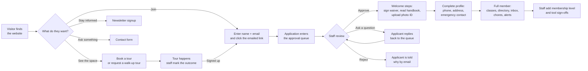
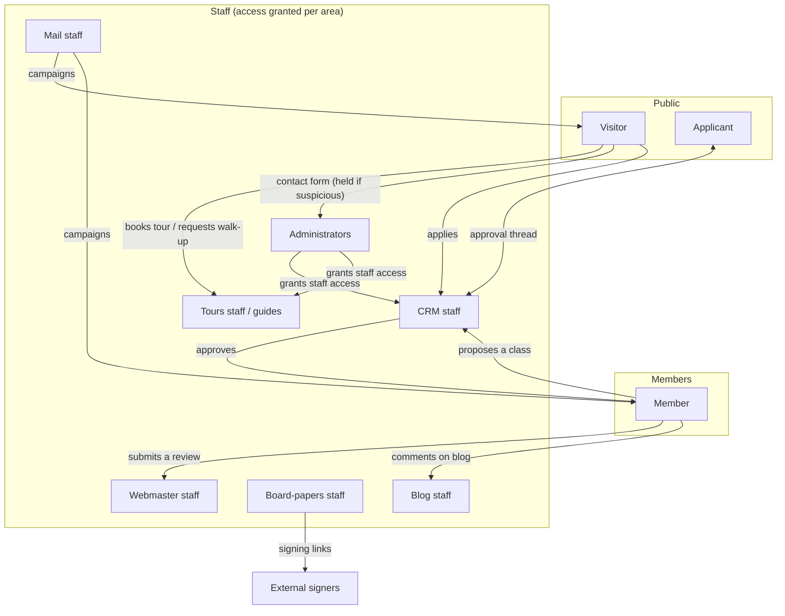

# Business Process Overview: Kzoo Makers Website

> **Start here.** This is the executive-level picture of how the Kzoo Makers website operates as a connected system. It is written for board members, operations staff and other non-developers. Every claim was checked against the source code; technical readers can follow the **Implementation evidence** references (paths are relative to the `web/` folder).

## Documents in this set

| Document | What it answers |
| --- | --- |
| [PROCESS_CATALOG.md](PROCESS_CATALOG.md) | What business processes exist, who takes part, how they connect |
| [WORKFLOW_DIAGRAMS.md](WORKFLOW_DIAGRAMS.md) | Step-by-step workflows with diagrams (success, failure, alternatives) |
| [BUSINESS_RULES.md](BUSINESS_RULES.md) | Every limit, restriction and decision rule, and how sure we are of it |
| [ROLES_AND_RESPONSIBILITIES.md](ROLES_AND_RESPONSIBILITIES.md) | Who can do what (and what the screen shows vs. what the server enforces) |
| [DATA_LIFECYCLES.md](DATA_LIFECYCLES.md) | The life of each business record: statuses, transitions, deletion |
| [PROCESS_GAPS.md](PROCESS_GAPS.md) | Missing, contradictory or unclear processes that need a decision |

## What the application is

The site serves two audiences at once:

1. **The public** sees the makerspace's marketing website (pages, hours, calendar, blog, pricing, handbook) and can book a tour, send a message, subscribe to the newsletter, or apply for membership.
2. **Members and volunteers** get a private members area (classes, directory, inbox, volunteer chores, phone alerts) and **staff** get an admin area to run the organization (approve applicants, run tours, send email, sign board papers, edit the website).

The site does **not** take payments. Dues, class fees and invoices are handled outside the application; the only trace of billing is a free-text QuickBooks ID on a person's record and a "price" text on classes. (See [PROCESS_GAPS.md](PROCESS_GAPS.md), gap G-01.)

## The member journey, end to end

**In plain English:** a person gets to know the space (often through a tour), creates an account by entering their name and email and clicking a link we email them, and waits in a queue. A staff member with CRM access reviews them, may ask a question, and then approves or declines. On approval the person must, in order, sign the liability waiver, read the handbook and upload a government photo ID, and then fill in contact details and an emergency contact. Only then are they a full member who can use the members area. Staff separately record the person's membership level and which tools they are cleared to use.

## The seven areas the system supports

| # | Area | One-line summary |
| --- | --- | --- |
| 1 | **Membership & onboarding** | Self-registration, staff approval with a two-way message thread, waiver, handbook, ID, profile |
| 2 | **Tours** | Guides publish time blocks; visitors book; walk-up requests are matched to volunteers; reminders, messages, statistics |
| 3 | **Classes** | Staff or members (with approval) put classes on the calendar; members sign up; waitlist is automatic |
| 4 | **Volunteer chores** | Recurring chores, time tracking, hours totals, achievements; also driven by an outside system via API key |
| 5 | **Communications** | Newsletter/email campaigns, contact forms with spam holding, in-app inbox, phone push alerts, member-to-member messaging |
| 6 | **Governance & documents** | Electronic signing of board papers, versioned membership agreement, handbook change announcements, public financial reports |
| 7 | **Website, blog & administration** | Page editing with history and undo, blog with comment moderation, reviews, staff access control, audit log |

## How work moves between people

Staff do not all have the same powers. Each staff member is given **no access, read-only, or read-and-change** for each of nine areas (webmaster, mail, blog, forms, CRM, board, tours, chores, admin). Details in [ROLES_AND_RESPONSIBILITIES.md](ROLES_AND_RESPONSIBILITIES.md).

## Things that run automatically (no human involved)

| What | How often | Effect |
| --- | --- | --- |
| Email delivery and retry | Every minute | Sends queued mail; failed mail is retried after 2, 4, 8 … minutes (up to 6 hours apart), at most 8 tries |
| Scheduled and interrupted email campaigns | Every minute | Starts campaigns whose time has come; resumes ones cut off by a restart |
| Tour reminders | Every minute | Writes "due now / in 1, 3 or 6 hours" lines into the tours timeline |
| Untaken walk-up alert | Every 30 minutes | Announces walk-up requests nobody has claimed after the configured number of days (default 3) |
| Old-data cleanup | Every 6 hours | Deletes audit entries, page history, tour timeline, email clicks, contact messages and notifications older than 5 years; also sent campaigns older than 5 years |
| Expiry of sign-in links and codes | On use | Links last 30 minutes (sign-in), up to 7–90 days (emailed message links), 24 hours (password reset) |

Evidence: `instrumentation.ts`, `lib/mail.ts` (`tick`), `lib/tours.ts` (`checkReminders`, `checkStale`), `lib/retention.ts`.

## Headline findings

The full list is in [PROCESS_GAPS.md](PROCESS_GAPS.md). The ones most relevant to leadership:

1. **No dues or payment process exists in the system.** Membership "levels" are typed in by staff and never expire or lapse. (G-01, G-02)
2. **Applicants can wait indefinitely.** Staff are notified of new applicants, but nothing reminds them if an application sits untouched (unlike walk-up tour requests, which have a reminder). (G-03)
3. **Several people are never told about changes that affect them:** a waitlisted class attendee who moves up, attendees of a cancelled class, and a board-paper requester when a signer declines. (G-05, G-06, G-07)
4. **Long-term retention of personal records is undefined.** The 5-year cleanup does not cover member records, signed waivers, or ID images. (G-08)
5. **The "at least 3 administrators" safeguard only counts site accounts,** not Google-allow-list administrators, which can make it impossible to remove an administrator. (G-09; inferred, needs confirmation)

## How to read confidence labels

Throughout this documentation:

| Label | Meaning |
| --- | --- |
| ✅ **Enforced** | The server code checks this; it cannot be bypassed by the user interface |
| 🔶 **Inferred** | Concluded from several code paths; not stated in one place |
| 🖥️ **Interface only** | Shown or implied on screen but not checked by the server |
| ❔ **Open question** | Cannot be confirmed from the code; needs a stakeholder decision |

## Coverage and limitations

- **Inspected:** all of `web/lib` business modules, `auth.ts`, `middleware.ts`, `instrumentation.ts`, every API route's permission check, and the member home page. Admin and member **screen components** (`app/admin/**`, `app/members/**` UI files) were sampled, not read line by line; behavior was traced through the server modules they call.
- **Not inspected:** the free-form page content in `data/pages`, the text of the membership agreement (`data/waiver-*.json`), CSS/visual design, and anything configured outside the repository (the live environment variables, Google Workspace settings, SMTP2GO account, the real list of administrators).
- **Runtime facts not knowable from code:** who currently holds which permission, which email addresses receive tour notifications, how the outside "YAMNet" volunteer system is used day to day.
- No application code was modified.
