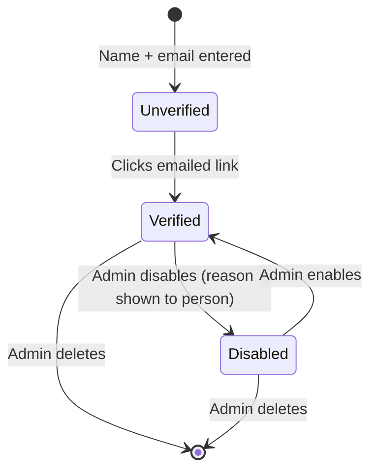
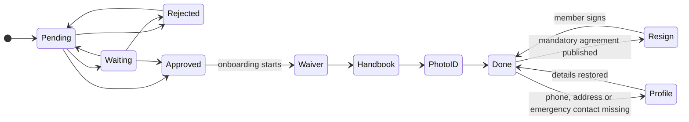
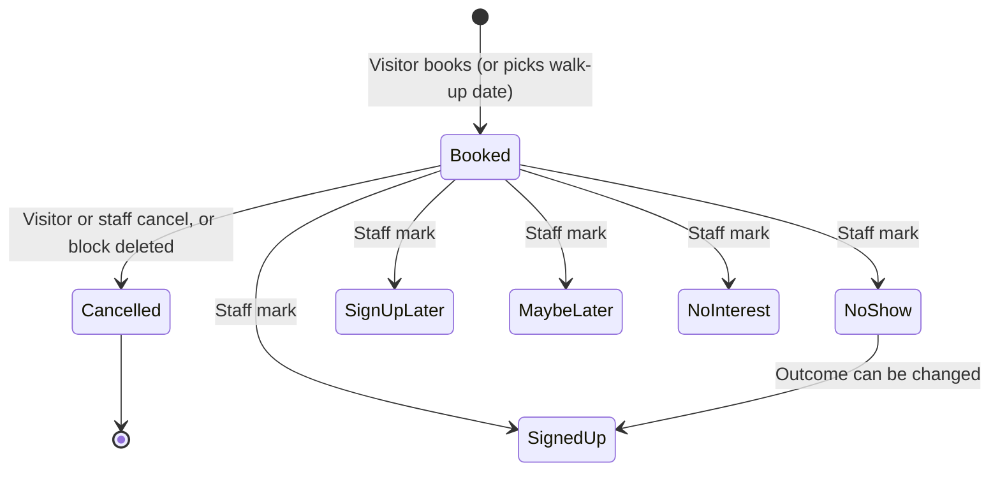
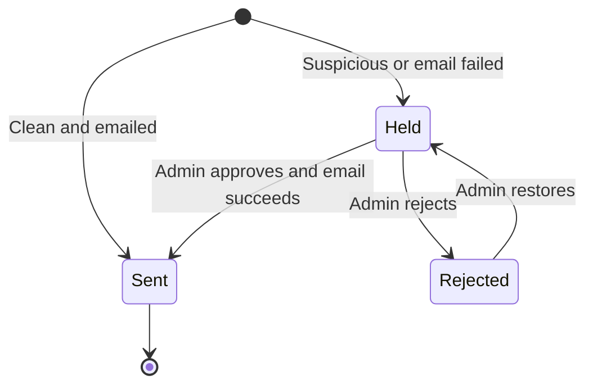
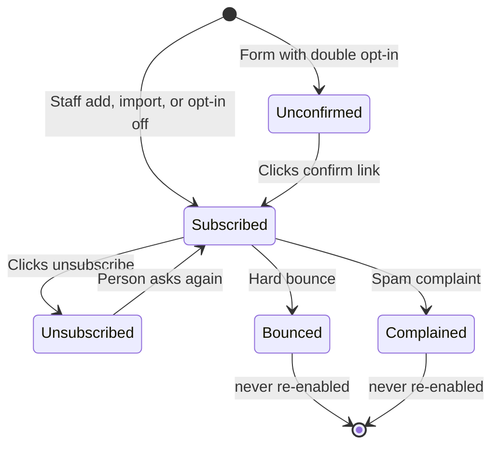

# Data Lifecycles

How each important business record is created, changes status, and ends. Back to the [Overview](BUSINESS_PROCESS_OVERVIEW.md). Workflows: [WORKFLOW_DIAGRAMS.md](WORKFLOW_DIAGRAMS.md). Paths are relative to `web/`.

## Summary table

| Object | Created by | Owner / manager | Statuses | Ends how |
| --- | --- | --- | --- | --- |
| Account | Visitor registers | Member (self), CRM staff, admins | unverified → verified; enabled / disabled | Admin deletes (no self-delete) |
| Application (approval) | Email verification | CRM staff | Pending, Waiting, Rejected, Approved | Stays on record |
| Onboarding | Approval | Member | waiver → handbook → id → done (+ resign, profile) | Done |
| Membership agreement version | CRM staff | CRM staff | Draft is not saved; published = permanent | Never deleted |
| Signed waiver | Member | Member / CRM | complete | Kept after account deletion |
| Photo ID | Member | CRM staff view | one per member (replaced on re-upload) | Deleted with the account |
| Membership level | CRM staff | CRM staff | held / removed | Staff remove it |
| Tool sign-off | CRM staff | CRM staff | active / expired (advisory) | Staff revoke |
| Tour block | Tours staff | Tours staff | upcoming / past | Staff delete (cancels bookings) |
| Tour booking | Visitor / walk-up pick | Tours staff, visitor (cancel) | booked → outcome; cancelled | Stays |
| Walk-up request | Visitor | Tours staff | Open, Offered, Scheduled, Closed | Stays |
| Class | CRM staff / approved proposal | CRM staff | scheduled / cancelled | Staff delete |
| Class proposal | Member | CRM staff | Pending, Approved, Declined (or withdrawn = deleted) | Stays |
| Chore | Chores staff | Chores staff | active / retired | Retired, never erased |
| Chore time entry | Member / outside system | Member; staff can delete | open → finished | Staff delete |
| Contact message | Visitor | Forms staff | Sent, Held, Rejected | Deleted by staff or after 5 years |
| Mailing-list person | Form / staff / automatic | Mail staff | unconfirmed, subscribed, unsubscribed, bounced, complained | Erased by staff |
| Email campaign | Mail staff | Mail staff | draft, scheduled, sending, sent | Trashed, or deleted after 5 years if sent |
| Board paper | Board-papers staff | Board-papers staff | Open, Complete, Expired, Void | Stays |
| Blog post | Blog staff | Blog staff | draft, published (scheduled) | Staff delete |
| Comment | Reader | Blog staff | Approved, Pending, Spam, Hidden | Deleted by staff |
| Review | Member | Webmaster staff | Pending, Approved, Rejected | Staff delete |
| Notification | System | Recipient | unread → read | Deleted after 5 years |
| Audit entry | System | Administrators | – | Deleted after 5 years |

---

## 1. Account

- **Created** by anyone entering a new name + email (max 3 per hour site-wide). **Owner:** the person edits phone, address, name; staff edit email, card number, QuickBooks ID, notes.
- **Not visible** until verified; unverified accounts never appear in staff lists.
- **Disabled:** sessions and links stop at once; reversible.
- **Deleted:** the account, its ID image, emergency contacts, memberships, tool sign-offs, skills, messages, comments, approval thread and access are removed. **Signed agreements remain** with the link to the account cleared; chore hours remain under the saved name. No one can delete themselves; the founder and the last administrators are protected.
- **Restore:** disabled → yes. Deleted → no.

Evidence: `lib/readers.ts`, `lib/profiles.ts`, `lib/db.ts` (foreign keys: `ON DELETE CASCADE` / `SET NULL`).

## 2. Application and onboarding

- **Status changes** are made by CRM staff (approval) or by the member completing a step (onboarding). Each approval change adds a line to the applicant's thread (who, when, why) and to the audit log.
- **Resign** and **Profile** are computed at sign-in from current facts, not stored states: they appear and disappear automatically.
- A member who already holds a signed waiver is not asked to sign again on re-approval.
- **Becoming "listed" as a member** (Members mailing list) happens once when waiver + ID + emergency contact all exist.

Evidence: `lib/approvals.ts`, `lib/onboarding.ts`, `lib/waiver.ts` (`STEP_SQL`).

## 3. Membership agreement and signed waiver

- **Version:** created only by publishing; has a revision label, sections, closing text, change summary, mandatory flag, author, date. **Cannot be edited or deleted.** Staff see how many members signed each.
- **Signed waiver:** one per signing. Contains the PDF (digitally sealed if a certificate exists), a fingerprint of the content, and which version was signed. Status goes straight to *complete*. A member accumulates a history of signed versions; the Account page shows what changed between them.
- **Retention:** no cleanup; survives account deletion. See [G-08](PROCESS_GAPS.md#g-08).

Evidence: `lib/waiver.ts`, `lib/sign.ts` (`signWaiver`, `finalize`).

## 4. Tours

Outcome labels can be changed freely while the booking is not cancelled. "Signed up" is a **label**; it does not create an account. Walk-up request statuses are in [W-08](WORKFLOW_DIAGRAMS.md#w-08-walk-up-tour-request). A **block** is deleted only by staff (cancelling its upcoming bookings); past blocks remain for statistics. The tour timeline and notes are deleted after 5 years.

Evidence: `lib/tours.ts`.

## 5. Class and class proposal

- **Class:** created by staff or by approving a proposal. Can be edited, marked cancelled, or deleted (sign-ups are deleted with it). Members' places are derived from sign-up time every time, so they are never stored as "confirmed/waitlist".
- **Proposal:** Pending → Approved (creates class) or Declined (reason kept, proposer notified). A pending proposal can be withdrawn by its author (deleted, with its poster image). Decided proposals remain.

Evidence: `lib/crm.ts`.

## 6. Chores and time

- **Chore:** active → retired (never erased; history stays). Snooze is temporary.
- **Time entry:** *open* (started) → *finished* (end time + minutes). Entries record how they were made (web, API) and by which outside key or user. Staff can delete entries. Entries keep the member's name as it was if the member is later deleted.
- **Achievement:** active → retired; who has earned it is **recalculated** from the log each time.

Evidence: `lib/chores.ts`, `lib/chores-calc.ts`.

## 7. Contact message

Messages can be deleted by staff and are removed automatically after 5 years.

## 8. Mailing-list person and campaign

A **campaign** goes draft → (scheduled) → sending → sent; each recipient has pending / sent / failed, and opens and clicks. Interrupted sending resumes after a restart. Trash is possible for drafts; sent campaigns are deleted after 5 years with their recipient data. Staff can export or **erase** a person entirely.

Evidence: `lib/mail.ts`.

## 9. Board paper (signing request)

See the state diagram in [W-19](WORKFLOW_DIAGRAMS.md#w-19-board-document-e-signing). Per-signer progress: *not sent → sent → opened → signed* or *declined*. Completed papers hold the encrypted final PDF and a fingerprint. Templates can be created, reused and deleted; a public link can be switched on and off.

## 10. Blog post, comment, review

- **Post:** draft ⇄ published (with optional future time). Every save is a snapshot that can be restored. Delete is permanent for the live post but earlier snapshots stay in the audit log until the 5-year cleanup.
- **Comment:** Approved / Pending / Spam / Hidden; staff can move between them; deleting a comment removes its replies. Readers cannot edit or delete their comments 🔶 (no such route found).
- **Review:** Pending → Approved (copied onto the homepage; later deleting the submission does not remove it from the homepage) or Rejected; restore returns it to Pending.

Evidence: `lib/blog.ts`, `lib/comments.ts`, `lib/reviews.ts`.

## 11. Website content

Every page, menu, hours, board and setting keeps a history of changes in the audit log (who, when, before/after). Reverting creates a new entry. Deleted pages can be restored (with menu links). History is deleted after 5 years.

Evidence: `lib/store.ts`.

## 12. Notifications

Created by system events (approval waiting, applicant replied, class proposal, class approved/declined, member message, comment reply). Unread → read (by the recipient only). Deleted after 5 years. Phone-alert messages are separate and are dropped if unread for 60 days.

Evidence: `lib/notifications.ts`, `lib/retention.ts`, `lib/ntfy.ts`.
