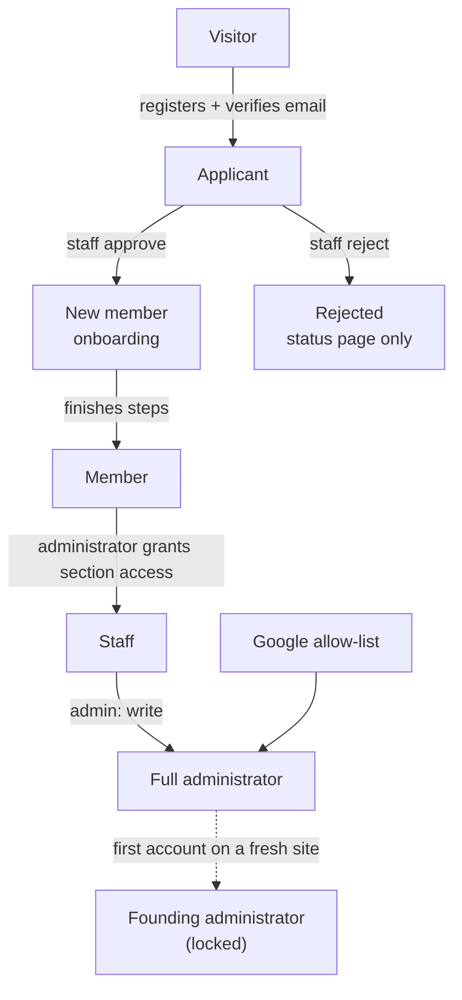

# Roles and Responsibilities

Who can do what in the Kzoo Makers system. Back to the [Overview](BUSINESS_PROCESS_OVERVIEW.md). Paths are relative to `web/`.

**Important distinction:** the screens hide things people are not allowed to use, but the real protection is in the server. Every cell below marked ✅ is **enforced by the server**; 🖥️ means only the screen limits it.

## 1. The roles

| Role | Who they are | How they get it |
| --- | --- | --- |
| **Visitor** | Anyone on the internet | Nothing needed |
| **Applicant** | Verified account not yet approved (Pending, Waiting) or Rejected | Verify email after registering |
| **New member** | Approved, still finishing waiver / handbook / ID / profile | CRM staff approve |
| **Member** | Approved and onboarding complete | Finish onboarding |
| **Staff (per section)** | A member given *read* or *write* on one or more of nine sections: webmaster, mail, blog, forms, CRM, board, tours, chores, admin | A full administrator grants it |
| **Full administrator** | `admin: write`: every section, plus user and system management | Granted by another administrator, or by being on the Google allow-list |
| **Google administrator** | Person on the `ADMIN_EMAILS` list who signs in with Google | Configured outside the app; counts as full administrator |
| **Founding administrator** | The locked first administrator of a fresh site | Automatic; cannot be changed/disabled/deleted |
| **Tour guide / volunteer** | A name and email typed onto a tour block, or a person who takes a walk-up request | Not a system role: guides need not have accounts |
| **Outside signer** | Person emailed a personal signing link (signer / approver / viewer / cc) | Added to a board paper |
| **Newsletter subscriber** | Email on a mailing list | Signup form or staff |
| **Outside system ("YAMNet")** | Software using an API key with scopes `chores:read` / `chores:write` | Administrator creates a key |
| **System** | Automatic timers and background jobs | – |

Staff with site accounts must be **approved and fully onboarded** to use their admin powers (they use the member sign-in). 🔶 Inferred from `lib/guard.ts` `me()` falling back to `currentMember()`.

## 2. Responsibilities by role

| Role | Responsible for |
| --- | --- |
| **Applicant** | Keeping contact details true; answering staff questions |
| **Member** | Signing the waiver (and any mandatory update), keeping profile and emergency contacts current, logging volunteer time honestly, following the handbook |
| **CRM staff** | Approving or declining applicants, communicating with them, recording membership levels and tool sign-offs, managing classes and proposals, publishing agreement versions, viewing IDs when needed |
| **Tours staff / guides** | Publishing availability, taking walk-up requests, messaging visitors, recording outcomes, choosing who is notified |
| **Mail staff** | Lists, signup forms, campaigns, subscriber hygiene |
| **Forms staff** | Reviewing held contact-form messages |
| **Blog staff** | Writing posts, authors, categories, media, and moderating comments |
| **Board-papers staff** | Creating and tracking signature requests, reminders, voiding |
| **Webmaster staff** | Page content, menu, hours, calendar, board of directors, handbook, reviews, financial PDFs, robots rules |
| **Chores staff** | Defining chores, achievements, correcting the time log |
| **Full administrator** | Granting staff access, disabling/deleting accounts, resetting passwords, system settings, keys, certificate, retention, monitoring |

## 3. Role-to-capability matrix (server-enforced)

Legend: ✅ allowed · ◐ read-only · — not allowed · 🔑 only with the named staff section

| Capability | Visitor | Applicant | Member | Staff (section) | Full admin |
| --- | :-: | :-: | :-: | :-: | :-: |
| Browse public site, calendar, blog | ✅ | ✅ | ✅ | ✅ | ✅ |
| Register / sign in | ✅ | ✅ | ✅ | ✅ | ✅ (also Google) |
| Book a tour / request walk-up | ✅ | ✅ | ✅ | ✅ | ✅ |
| Send contact / board message | ✅ | ✅ | ✅ | ✅ | ✅ |
| Subscribe to a newsletter | ✅ | ✅ | ✅ | ✅ | ✅ |
| Comment on blog posts | — | ✅ (not if Rejected) | ✅ | ✅ | ✅ |
| See own approval thread; reply | — | ✅ (while Pending/Waiting) | — | — | — |
| Sign waiver, upload ID, complete profile | — | — | ✅ (when approved) | ✅ | ✅ |
| Members home, classes, directory, inbox, alerts | — | — | ✅ | ✅ (if also member) | ✅ (if also member) |
| Propose a class (max 3 waiting) | — | — | ✅ | ✅ | ✅ |
| Submit a review | — | — | ✅ | ✅ | ✅ |
| Log own volunteer time | — | — | ✅ | ✅ | ✅ |
| Approve / reject / message applicants | — | — | — | 🔑 CRM write | ✅ |
| View approval queue | — | — | — | 🔑 CRM read | ✅ |
| Set membership levels, tool sign-offs | — | — | — | 🔑 CRM write | ✅ |
| View a member's photo ID | — | — | — | 🔑 CRM read (always logged) | ✅ |
| Publish agreement version | — | — | — | 🔑 CRM write | ✅ |
| Create / edit classes, decide proposals | — | — | — | 🔑 CRM write | ✅ |
| Activate a walk-up as a member | — | — | — | 🔑 Tours write **and** CRM write | ✅ |
| Manage tour blocks, requests, messages | — | — | — | 🔑 Tours write | ✅ |
| View tour data and statistics | — | — | — | 🔑 Tours read | ✅ |
| Compose and send campaigns, manage lists | — | — | — | 🔑 Mail write | ✅ |
| Approve held contact messages | — | — | — | 🔑 Forms write | ✅ |
| Write/publish blog; moderate comments; media | — | — | — | 🔑 Blog write | ✅ |
| Create board papers, remind, void | — | — | — | 🔑 Board write | ✅ |
| Edit pages, menu, hours, handbook, reviews, financials | — | — | — | 🔑 Webmaster write | ✅ |
| Manage chores and achievements | — | — | — | 🔑 Chores write | ✅ |
| Grant staff access; disable/delete accounts | — | — | — | — | ✅ |
| Change email/password of someone with staff access | — | — | — | — | ✅ |
| Audit log, HTTP log, DB stats, privacy text, security headers | — | — | — | — | ✅ (read via Admin read) |
| API keys, signing certificate, upload limits, setup | — | — | — | — | ✅ |
| Change **own** Admin access | — | — | — | — | — (blocked for everyone) |
| Change/disable/delete founding administrator | — | — | — | — | — (blocked for everyone) |

Notes:
- "Staff (section)" means that member holds the named section at the stated level. **Write** includes read.
- A section with *read* lets staff view but not change; the server returns "not found" to those without even read access.
- A few shared screens (media library, uploads) are available to whoever holds blog, mail or webmaster write 🔶 (`app/api/webmaster/upload/route.ts`).
- Admin-area "alert" counts (e.g., applicants waiting, held messages) are shown to staff holding that section's read access.

## 4. What each role can **see** (information visibility)

| Information | Visitor | Applicant | Member | Staff |
| --- | :-: | :-: | :-: | --- |
| Public pages, hours, calendar, financial PDFs | ✅ | ✅ | ✅ | ✅ |
| Own name/email/phone/address | – | ✅ | ✅ | – |
| Other members' info | — | — | Only directory-listed members: first name + last initial, bio, skills, facts, and phone/email/Discord/social **only if that member ticked them** | CRM staff see full profile, contact details, emergency contacts, approval history |
| Staff-only notes about an applicant | — | — | — | CRM staff |
| Photo ID | — | — | — | CRM staff; each view audited |
| Signed waiver PDF | — | Own (once signed) | Own | CRM or board staff |
| Tour visitor details (phone, email, device info) | — | — | — | Tours staff |
| Internal tour notes | — | — | — | Tours staff |
| Held contact messages | — | — | — | Forms staff |
| Mailing-list subscribers | — | — | — | Mail staff |
| Volunteer hours, stats, achievements | — | — | Everyone sees the chores, hours, stats | Chores/CRM staff manage |
| Audit log, request log | — | — | — | Administrators |

## 5. Approval authority

| Decision | Who decides | Notes |
| --- | --- | --- |
| Applicant becomes a member | CRM write or full admin | Must confirm details checked ✅ |
| Walk-up visitor becomes a member immediately | Tours write **and** CRM write | Skips queue and email verification |
| Member-proposed class goes on the calendar | CRM write or full admin | Reason required to decline |
| Review appears on homepage | Webmaster write | May edit text first |
| Comment appears | Blog write | Or automatic by moderation mode |
| Held contact message is sent | Forms write | |
| Staff access levels | Full admin | Safeguards in [BR-D4–D7](BUSINESS_RULES.md#d-staff-access-and-account-control) |
| Mandatory re-signing of the agreement | CRM write | Binds all members |
| Board paper becomes valid | The named signers/approvers | No staff approval needed |

**There is no two-person rule:** one CRM staff member can approve an applicant, grant tool sign-offs, publish a mandatory agreement update and view IDs. (G-18)

## 6. Interactions between roles

| From → To | Interaction | Channel |
| --- | --- | --- |
| Applicant ↔ CRM staff | Questions and answers | Email link + thread on the status page |
| Visitor ↔ Tours staff | Tour scheduling and messages | Emailed links, no account |
| Member ↔ Member | Private messages | In-app inbox + email notice (addresses hidden) |
| Member → CRM staff | Class proposal | In-app notification to all CRM staff |
| CRM staff → Member | Approval, decline reasons | In-app notification and email |
| Staff → Outside signers | Signing request | Personal emailed link |
| Outside system → Chores | Read/start/finish/log | API key |
| Administrator → Disabled person | Notice of suspension | One email + phone alert on their next sign-in attempt |
