# Workflow Diagrams

Step-by-step business workflows with diagrams. Back to the [Overview](BUSINESS_PROCESS_OVERVIEW.md) · [Catalog](PROCESS_CATALOG.md) · [Rules](BUSINESS_RULES.md) · [Gaps](PROCESS_GAPS.md).

Diagrams render natively on github.com (Mermaid). Every diagram shows only behavior verified in the code. Source paths are relative to `web/`.

**Contents:** [W-01 Sign-in](#w-01-registration-and-sign-in) · [W-02 Approval](#w-02-membership-application-approval) · [W-03 Recovery](#w-03-account-recovery-and-passwords) · [W-04 Onboarding](#w-04-member-onboarding) · [W-05 Agreement versions](#w-05-membership-agreement-versions-and-re-signing) · [W-06 Suspension & access](#w-06-account-suspension-deletion-and-staff-access) · [W-07 Tour booking](#w-07-tour-booking-and-availability) · [W-08 Walk-up](#w-08-walk-up-tour-request) · [W-09 Tour conversation](#w-09-tour-conversation-and-outcome-tracking) · [W-10 Tour notices](#w-10-tour-notifications-and-reminders) · [W-11 Classes](#w-11-class-scheduling-and-sign-up) · [W-12 Proposals](#w-12-class-proposal-and-approval) · [W-13 Levels & tools](#w-13-membership-levels-and-tool-sign-offs) · [W-14 Directory](#w-14-member-directory-and-messaging) · [W-15 Chores](#w-15-volunteer-chores-and-time-tracking) · [W-16 Contact form](#w-16-contact-form-and-spam-holding) · [W-17 Newsletter](#w-17-newsletter-subscription-and-campaigns) · [W-18 Handbook](#w-18-handbook-change-announcement) · [W-19 Board signing](#w-19-board-document-e-signing) · [W-20 Blog](#w-20-blog-publishing-and-comment-moderation) · [W-21 Reviews](#w-21-member-review-to-homepage) · [W-22 Website editing](#w-22-website-content-editing-history-and-undo) · [W-23 Monitoring](#w-23-monitoring-and-data-retention)

---

## W-01 Registration and sign-in

**Business purpose:** Let anyone create an account or return to it without remembering a password, while stopping bots and stopping strangers from learning who has an account.

**Participants:** Visitor (becomes Applicant or Member), the system, outside email service.

**Starting event:** The visitor enters their email (and name, if new) on the sign-in page.

**Preconditions:** Email sending must be configured by an administrator (a default sender address and a mail provider key). If not, the visitor sees "Email isn't set up yet."

**Normal process:**
1. The visitor enters email (and name if they are new).
2. The system checks the address looks valid, then applies spam limits: 5 requests per 10 minutes per network address, 60 sign-in emails per hour for the whole site, one email per account per minute, and no more than **3 brand-new accounts per hour** site-wide.
3. If the address is new and a name was given, an account is created in "pending" state. If the address is unknown *and no name was given*, nothing happens, but the screen answers the same as a success.
4. The system emails a one-time link that works **once for 30 minutes**.
5. The visitor clicks the link. The system verifies the address and starts a **30-day** session.
6. On the *first* verification the person is placed in the approval queue and staff are told (see [W-02](#w-02-membership-application-approval)); they also join the "Registered users" mailing list once approved.
7. Where they land depends on status: applicants go to the status page; members with unfinished welcome steps go to the welcome wizard; otherwise to the page they wanted or the members home.

**Alternative paths:**
- *Password sign-in:* a member who has set a password can use email + password instead.
- *First ever account on a brand-new site:* if no `ADMIN_EMAILS` is configured, the first verified account becomes the locked founding administrator and is auto-approved.
- *Administrators (Google):* people on the Google allow-list sign in with Google at a separate page; they never use this flow.

**Failure scenarios:**
- Invalid email, rate limit hit, or site-wide cap reached → a plain message asking them to try later.
- **Disabled account:** the person is *not* sent a link. Instead they receive an email and a phone alert saying the account is disabled, with the staff-written reason. This notice is sent only once until the account is enabled again.
- Expired or already-used link → sign-in fails and they must request another.
- Wrong password: the same message for every failure; 5 misses per address from one network, or 50 across everyone, locks password sign-in for 15 minutes.

**Business rules:** [BR-A1 – BR-A9](BUSINESS_RULES.md#a-sign-in-and-accounts).

**Result:** A signed-in session; account exists and is verified.

**Related workflows:** [W-02](#w-02-membership-application-approval), [W-03](#w-03-account-recovery-and-passwords), [W-06](#w-06-account-suspension-deletion-and-staff-access).

**Implementation evidence:** `lib/readers.ts` (`requestLink`, `consumeLink`, `passwordLogin`, `afterSignIn`), `app/blog/verify/route.ts`, `app/api/blog/auth/route.ts`, `auth.ts`.

**Open questions:** The 3-new-accounts-per-hour cap is site-wide. A busy open-house evening could lock out genuine applicants until an administrator presses reset (Admin → People & access). Is that intended? See [G-10](PROCESS_GAPS.md#g-10).

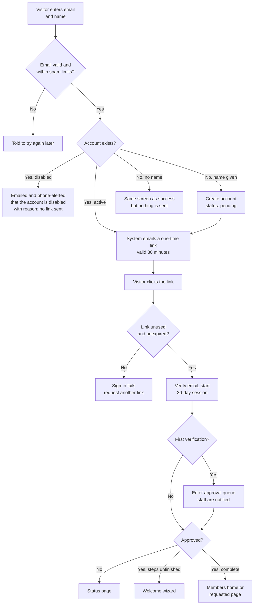

---

## W-02 Membership application approval

**Business purpose:** Make sure every person who gets member access has been looked at by a human, and keep a written trail of every question and decision.

**Participants:** Applicant; **CRM staff** (anyone with CRM access or full administrators); the system.

**Starting event:** A new account verifies its email (W-01 step 6).

**Preconditions:** The account is verified and not disabled.

**Normal process:**
1. The system records "Applied for membership" in the applicant's thread and adds them to the **Pending** list. Every CRM staff member and full administrator receives an in-app notification ("*Name* is waiting for approval").
2. A staff member opens the applicant. They see name, contact details and the full thread (messages, internal notes, status changes).
3. Staff choose one of:
   - **Ask a question** (optionally moving the applicant to *Waiting*): the applicant is emailed a one-click link (good for one week) to read and reply.
   - **Add an internal note**: never visible to the applicant.
   - **Approve**: staff must tick a box confirming they checked the name and contact details, and may correct first name, last name and phone. The applicant is placed at the first onboarding step (waiver) unless they already hold a signed waiver, added to the mailing list, and emailed a welcome link.
   - **Reject**: a reason can be given; the applicant is emailed it.
4. If the applicant replies, a *Waiting* application returns to *Pending* at the top of the queue and staff are notified.

**Alternative paths:**
- Staff may move an applicant between **any** two states (Pending, Waiting, Rejected, Approved), including un-rejecting.
- **Walk-up activation:** staff can approve a person on the spot from a walk-up tour request (see [W-08](#w-08-walk-up-tour-request)); this skips the queue and email verification (staff vouch for them).

**Failure scenarios:**
- Two staff act at once → the second sees "Someone else just changed this person. Reload."
- Approving without ticking the confirmation, or without a first name → refused.
- Attempting to move someone with admin access out of *Approved* → refused.
- Applicant sends more than 10 messages in an hour → asked to wait.
- Rejected applicants cannot reply ("This application is closed").
- If the welcome email cannot be sent (mail not set up), the approval still counts; staff are told it was not emailed.

**Business rules:** [BR-B1 – BR-B8](BUSINESS_RULES.md#b-approval).

**Result:** Applicant is *Approved* (and begins onboarding), *Rejected*, or still *Pending/Waiting*. Every step is in the thread and the audit log.

**Related workflows:** [W-01](#w-01-registration-and-sign-in), [W-04](#w-04-member-onboarding), [W-08](#w-08-walk-up-tour-request).

**Implementation evidence:** `lib/approvals.ts` (`applied`, `say`, `note`, `move`, `reply`, `activateWalkup`), `app/api/webmaster/crm/route.ts` (ops `applicants`, `applicantMove`, …), `app/api/pending/route.ts`.

**Open questions:** No target response time or reminder exists for stuck applicants ([G-03](PROCESS_GAPS.md#g-03)).

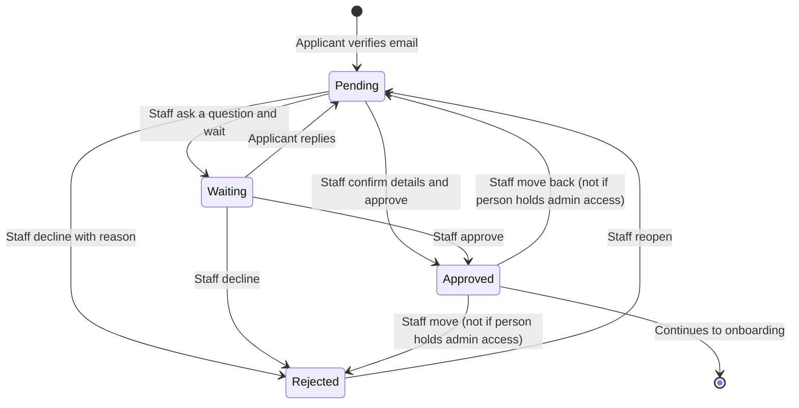

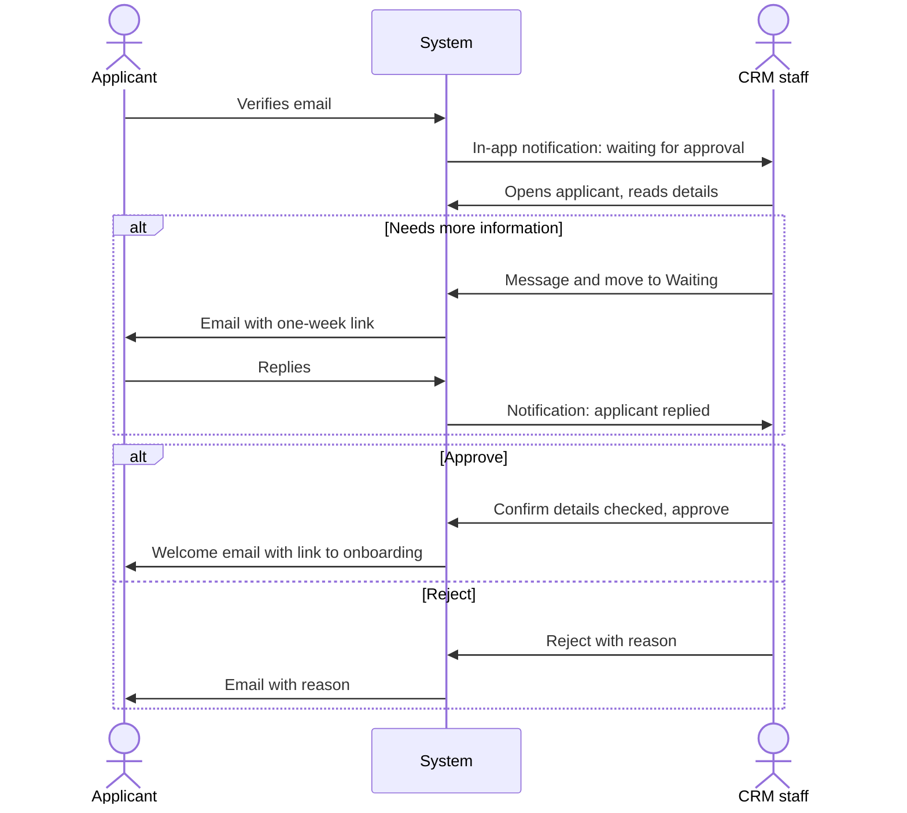

---

## W-03 Account recovery and passwords

**Business purpose:** Restore access when someone loses their way in, without putting accounts at risk.

**Participants:** Member, administrator (users with Admin access), system.

**Starting event:** The member requests a new sign-in link (same as W-01), *or* an administrator sends a reset or sets a password.

**Normal process (member):**
1. There is no "forgot password": the member simply requests an emailed sign-in link (W-01).
2. Once signed in, on the Account page they may set a password (min. 10 characters). If one exists, they must supply the current one to change it.
3. Setting or changing a password **signs out every other device**.

**Alternative path (administrator reset):**
1. An administrator sends a reset link (valid **24 hours**, works once). Clicking it signs the member in, **removes their old password**, signs out all devices, and opens the Account page so they can choose a new one without being asked for the old one.
2. An administrator may instead set a password directly (also signs out all devices).

**Failure scenarios:** Expired/used link → request another. Disabled account → see W-01.

**Business rules:** [BR-A5, A6, A10](BUSINESS_RULES.md#a-sign-in-and-accounts). Staff who hold *any* staff access can only have their email/password/account changed by a **full administrator** ✅ (`mayTakeOver`).

**Result:** The member regains access; old sessions are invalidated where relevant.

**Related:** [W-01](#w-01-registration-and-sign-in), [W-06](#w-06-account-suspension-deletion-and-staff-access).

**Implementation evidence:** `lib/readers.ts` (`sendReset`, `adminSetPassword`, `setPassword`, `session`), `app/api/blog/auth/password/route.ts`, `lib/profiles.ts` (`mayTakeOver`).

**Open questions:** None for the member path. Whether the first account on a new site (the "founder") has any recovery path other than an emailed link is ❔ not defined in code.

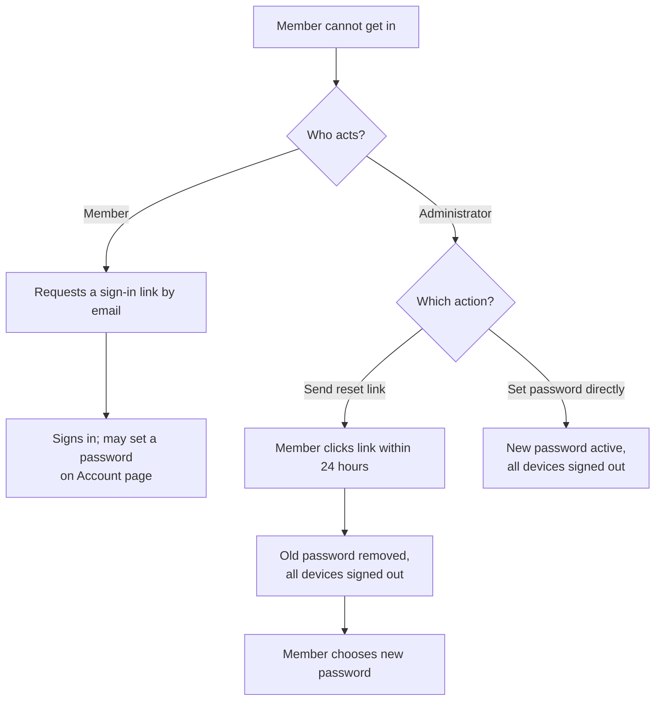

---

## W-04 Member onboarding

**Business purpose:** Make sure every member has agreed to the liability waiver, acknowledged the handbook, and provided a valid photo ID and emergency contact **before** using the members area.

**Participants:** Newly approved member; system; staff (view documents later).

**Starting event:** Staff approve the applicant (W-02), and the person next signs in.

**Preconditions:** Approved account, not disabled.

**Normal process (order is enforced by the server, not just the screen):**
1. **Waiver.** The member reads the current agreement, types their full name, enters initials and draws their signature. The system produces a signed PDF (digitally sealed if a certificate is configured), stores it encrypted, and emails a copy to the member and to the office (contact@kzoomakers.org).
2. **Handbook.** The member confirms they have read the handbook.
3. **Photo ID.** The member chooses the ID type (driver's licence/state ID, passport, military ID, college ID) and uploads a photo. Rules: must not be expired; expiry date is required except for college IDs. The image is re-encoded (stripping location data) and stored **encrypted**.
4. **Profile.** Phone, address and at least one emergency contact (name, phone, relationship) are required. Up to 10 contacts.
5. When waiver + ID + emergency contact are all present, the person is added **once** to the "Members" mailing list (an administrator removing them later sticks).
6. A one-time welcome screen is shown and never again.

**Alternative paths:**
- *Already signed a waiver before* (e.g., re-approval): the waiver step is skipped.
- *Newer mandatory agreement published* later: member is sent back to sign it (see W-05) before using the members area.
- *Profile gaps later* (phone/address/emergency contact removed): the member is routed to the profile step again.

**Failure scenarios:** Skipping ahead is refused ("Finish the earlier steps first"); replaying a step is refused ("That step isn't the one you're on"); expired ID is refused; upload larger than the configured limit is refused; email problems do not undo the signature.

**Business rules:** [BR-C1 – BR-C8](BUSINESS_RULES.md#c-onboarding-and-agreement).

**Result:** Member can use all members-only features; signed PDF and ID are on file; staff can view them (ID views are always logged).

**Related:** [W-02](#w-02-membership-application-approval), [W-05](#w-05-membership-agreement-versions-and-re-signing), [W-17](#w-17-newsletter-subscription-and-campaigns).

**Implementation evidence:** `lib/onboarding.ts`, `lib/waiver.ts` (`STEP_SQL`, `joinMembersIfDone`), `lib/sign.ts` (`signWaiver`, `finalize`), `app/api/onboarding/route.ts`, `app/api/onboarding/id/route.ts`, `lib/profiles.ts` (`saveContact`), `lib/vault.ts`.

**Open questions:** The handbook step is an acknowledgement checkbox only. There is no record of *which version* of the handbook was acknowledged and no reading check ❔. How long ID images are kept after someone leaves is undefined ([G-08](PROCESS_GAPS.md#g-08)).

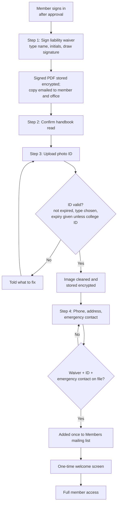

---

## W-05 Membership agreement versions and re-signing

**Business purpose:** Keep the liability agreement legally current. Published versions are permanent; changing the agreement means publishing a new version, optionally requiring everyone to sign again.

**Participants:** CRM staff (write access), all approved members, system.

**Starting event:** Staff publish a new agreement version.

**Normal process:**
1. Staff edit sections (heading + text) and closing statement, give a **new revision number**, and write a plain-language "what changed" summary. An AI helper can draft the summary; staff review it.
2. They choose whether it is **mandatory** (everyone must re-sign).
3. The system checks something really changed, the revision number is unused, and a summary exists, then saves it as a new permanent version.
4. If mandatory, every approved, active member is emailed (sent slowly, one every 0.2 seconds, in the background) with the summary and a sign-in link.
5. At each member's next sign-in they are routed to a "sign again" page showing what changed since the version *they* last signed. Until they sign, they are blocked from members-only features.
6. Staff can see which version each member has signed (or none).

**Alternative paths:** Non-mandatory versions are published without emails or blocking; they apply to people signing for the first time.

**Failure scenarios:** Nothing changed / duplicate revision / missing summary → publish refused. If the mail service is down the announcement is not sent (publishing still succeeds). Members can always download their own signed copies from their Account page.

**Business rules:** [BR-C9 – BR-C12](BUSINESS_RULES.md#c-onboarding-and-agreement).

**Result:** A new immutable version exists; members who must re-sign are gated until they do.

**Implementation evidence:** `lib/waiver.ts` (`publish`, `notifyMembers`, `changesFor`, `members`, `STEP_SQL`), `lib/waiver-diff.ts`, `app/api/webmaster/waiver/route.ts`.

**Open questions:** The email loop runs inside the web server process. If the server restarts mid-send, the remaining members are not emailed (they are still gated at sign-in) 🔶 ([G-11](PROCESS_GAPS.md#g-11)).

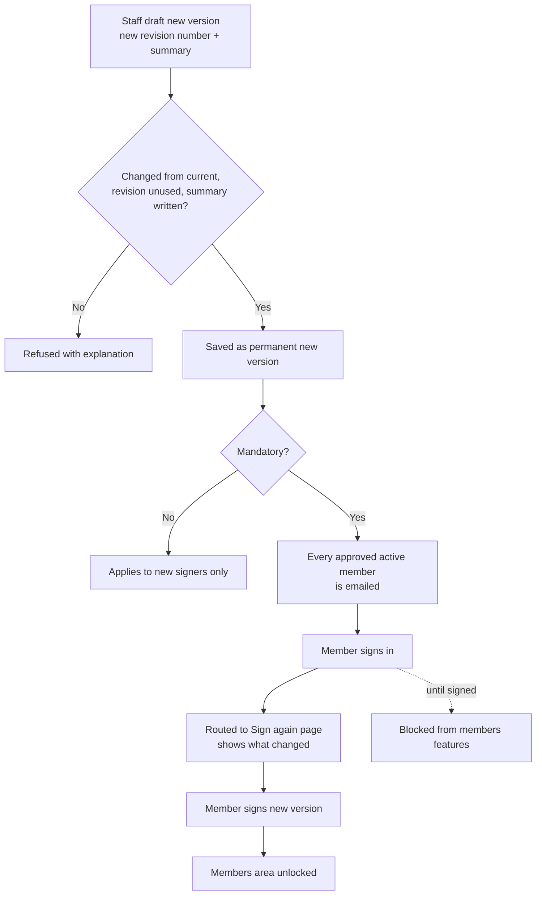

---

## W-06 Account suspension, deletion and staff access

**Business purpose:** Remove or limit access when needed, and hand out staff powers without any single mistake locking everyone out.

**Participants:** Full administrators; CRM staff (view/edit people); system.

**Starting event:** An administrator disables, deletes or changes a person's access.

**Normal process:**
1. **Disable:** staff give an optional reason (this is shown to the person). The person's links are cancelled, existing sessions stop working at once, and their phone-alert topics are locked. The person is emailed/alerted once if they try to sign in.
2. **Enable:** reverses the above; phone-alert topics are unlocked.
3. **Delete:** permanently removes the person and their account records (comments, emergency contacts, ID image, access, messages). **Signed agreements are kept** (detached from the account), and volunteer hours stay counted under the person's name as it was.
4. **Staff access:** for each of nine sections an administrator sets none, read, or write. `admin:write` is a full administrator and implies write everywhere.
5. Every action is recorded in the audit log.

**Safeguards (all ✅ enforced):**
- You cannot disable, delete or change the Admin access of **yourself**.
- The **founding administrator** (locked) cannot be changed, disabled or deleted.
- Removing full-admin rights, deleting, or disabling a full administrator is refused unless **more than 3** full administrators (site accounts) would remain.
- Only a full administrator can change the email/password/account of anyone who holds any staff access.

**Failure scenarios:** Any safeguard above produces a plain message ("At least 3 administrators must remain…").

**Business rules:** [BR-D1 – BR-D8](BUSINESS_RULES.md#d-staff-access-and-account-control).

**Result:** Access changes take effect immediately; audit entry written.

**Implementation evidence:** `lib/users.ts` (`setAccess`), `lib/profiles.ts` (`deleteUser`, `setDisabled`, `mayTakeOver`), `lib/guard.ts`, `app/api/webmaster/users/route.ts`.

**Open questions:** The "3 administrators" counts only site accounts with the `admin` section, not Google-allow-list administrators ([G-09](PROCESS_GAPS.md#g-09)). There is no "member resigns" path distinct from disabling.

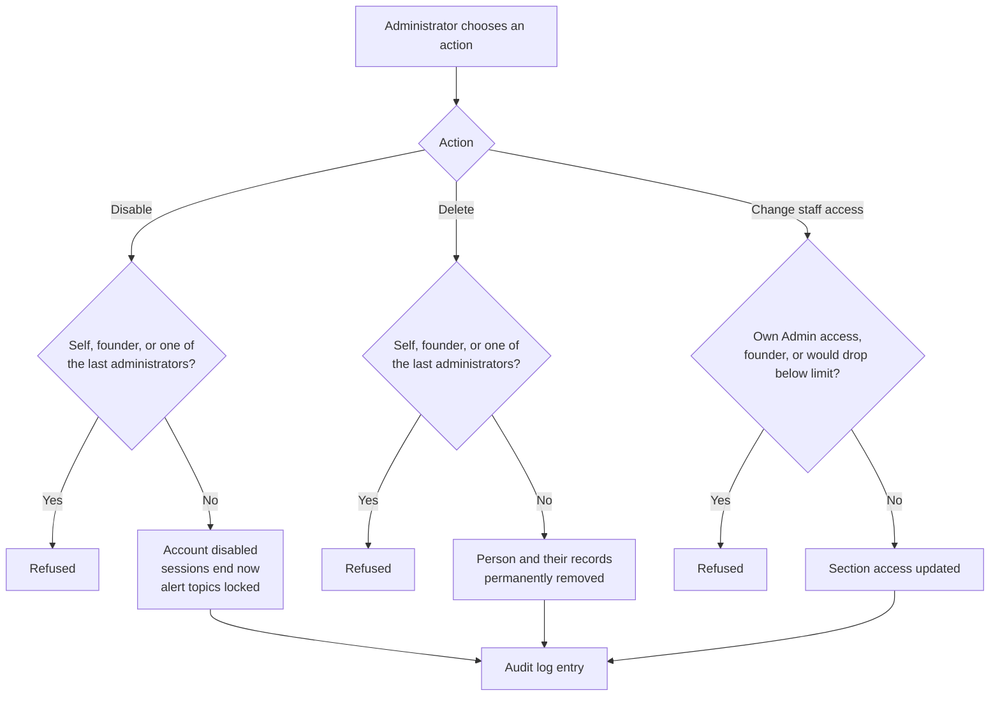

---

## W-07 Tour booking and availability

**Business purpose:** Let visitors choose a real tour time, while guides control when and how many people.

**Participants:** Tour guide (a name and email on an availability block), **tours staff**, visitor, system.

**Starting event:** A guide/staff creates availability, then a visitor books.

**Preconditions:** Availability blocks exist in the next 28 days; at least 4 hours ahead.

**Normal process:**
1. Staff create a **block**: date, start/end, length of each tour (5–480 minutes), people per tour (1–50), guide name and email.
2. The visitor sees open slots in the next 28 days (full slots and slots starting in less than 4 hours are hidden).
3. The visitor enters name, email, phone (10 digits), areas of interest, how they heard of us, and optional notes, then books.
4. The system locks the slot while checking so two people cannot take the last place; it rejects duplicates for the same person and enforces spam limits (5 per hour per network, 40 per hour overall).
5. The visitor gets a confirmation email with a **cancel link**; the guide gets an email; the tour channel gets a phone alert; the timeline and subscribed staff are updated.

**Alternative paths:**
- *Visitor cancels* via the emailed link: the booking is marked cancelled, the guide is emailed and alerted.
- *Staff cancel* a booking: the visitor is emailed.
- *Staff delete availability blocks:* everyone booked into upcoming tours is cancelled and emailed. Normal visitors get a "rebook" link; walk-up visitors are put back in line for a volunteer.

**Failure scenarios:** Slot filled or too soon → "no longer available"; duplicate → "already booked"; changing a block so that existing bookings would disappear or exceed capacity is refused.

**Business rules:** [BR-E1 – BR-E9](BUSINESS_RULES.md#e-tours).

**Result:** A booking exists; guide and staff are informed.

**Implementation evidence:** `lib/tours.ts` (`saveBlock`, `openSlots`, `book`, `cancelByToken`, `cancelBooking`, `deleteBlocks`), `app/api/tours/route.ts`, `app/api/tours/cancel/route.ts`.

**Open questions:** If a block's guide email is blank, no guide is emailed ❔. After a guide-cancel there is no automatic reassignment.

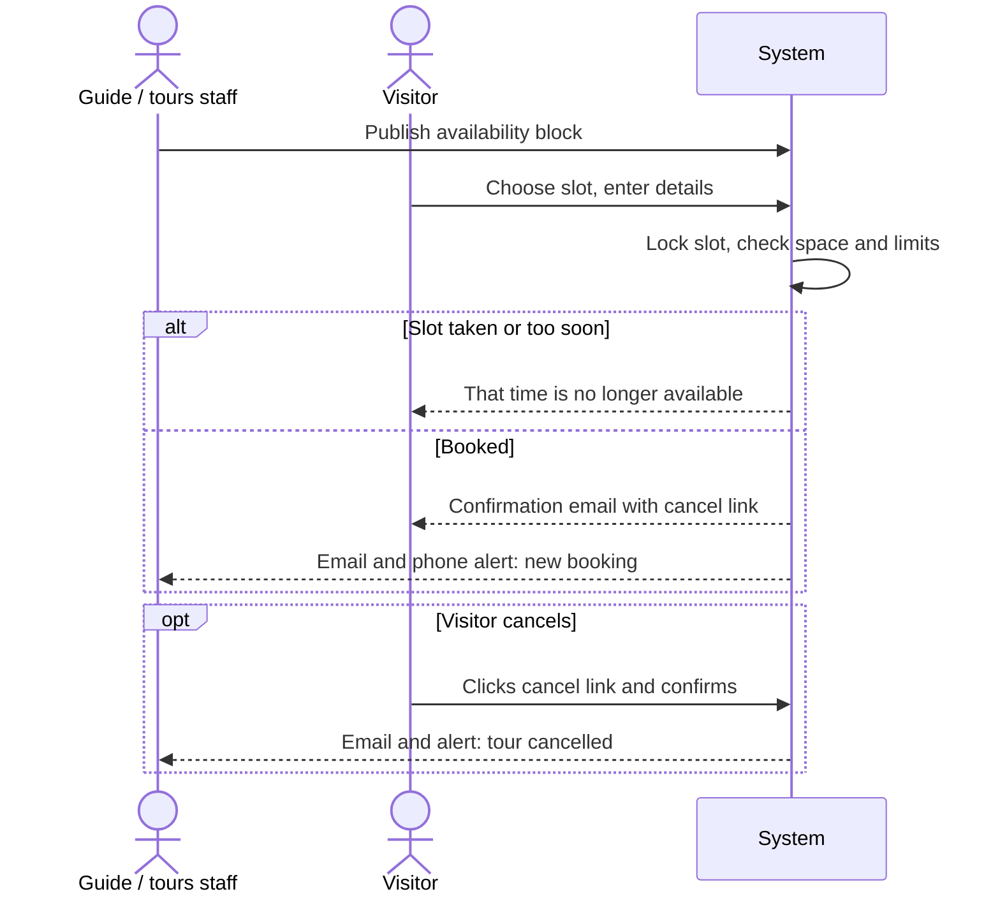

---

## W-08 Walk-up tour request

**Business purpose:** Never turn a visitor away when no times are open: collect the request and let a volunteer offer dates.

**Participants:** Visitor, volunteer guide/tours staff, system.

**Starting event:** A visitor submits the "request a tour" form (name, email, 10-digit phone, 5-digit zip, preferred contact method).

**Normal process:**
1. Request is saved as **Open**; subscribed staff are notified; it appears in the walk-up queue.
2. A volunteer **takes** it by proposing one or more dates and entering their own email.
3. The visitor is emailed one link per date plus "none of these work."
4. If the visitor **picks a date**, the system creates a one-person block and a booking, sets the request to **Scheduled**, emails the visitor (with cancel link) and the guide.
5. If the visitor **declines**, the request returns to **Open** with the visitor's note and a count of how many times they have asked for new dates; staff are notified.

**Alternative paths:**
- Staff can **dismiss** a request or **take back** an offer (status *Closed*), and reopen it.
- Staff can **activate** a walk-up on the spot: this approves the person as a member (needs CRM write access), puts them at the waiver step and emails a sign-in link. Refused if the person is disabled or was previously rejected.
- A visitor can cancel the scheduled tour, which closes the request.

**Failure scenarios:** Offers must be in the future (at least 4 hours ahead). A picked time that has passed is refused. A stale offer shows "no longer on offer." Email not set up → the offer cannot be sent.

**Business rules:** [BR-E10 – BR-E14](BUSINESS_RULES.md#e-tours).

**Result:** A scheduled tour, a closed request, or a request back in the queue.

**Implementation evidence:** `lib/tours.ts` (`requestTour`, `offerTimes`, `respond`, `setRequestStatus`, `checkStale`), `lib/approvals.ts` (`activateWalkup`), `app/api/tours/respond/route.ts`.

**Open questions:** Nothing limits how many times a visitor may bounce a request back ([G-12](PROCESS_GAPS.md#g-12)).

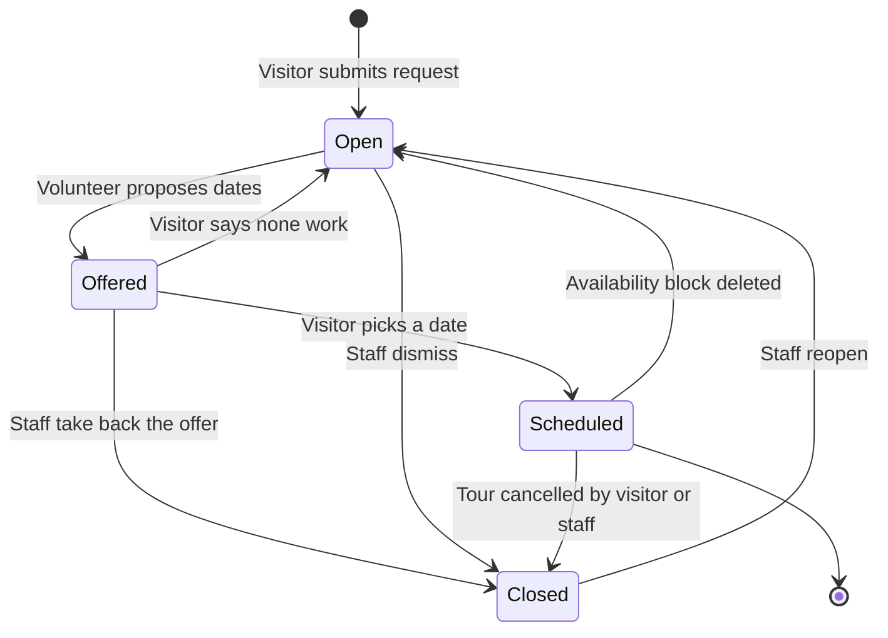

---

## W-09 Tour conversation and outcome tracking

**Business purpose:** Keep every message with a visitor in one place, and learn how many tours turn into members.

**Participants:** Tours staff, visitor.

**Normal process:**
1. Staff open a booking or request and either **email the visitor** (the visitor gets a link to reply) or add an **internal note** (never shown to the visitor).
2. The visitor replies from the link (max 10 messages per hour); staff are emailed and phone-alerted.
3. After a tour, staff set the outcome: *booked, no show, signed up, sign up later, maybe later, no interest*. The time of the first "signed up" is remembered.
4. A statistics page summarizes bookings, show rates, conversion, time-to-sign-up, interest areas, how people heard of us, per-guide results.

**Failure scenarios:** Email not configured → staff can still save an internal note. Cancelled bookings cannot have outcomes changed.

**Business rules:** [BR-E15 – BR-E17](BUSINESS_RULES.md#e-tours).

**Result:** A conversation history and outcome per visitor; conversion statistics.

**Implementation evidence:** `lib/tours.ts` (`postStaff`, `postVisitor`, `setStatus`, `stats`), `lib/tours-fmt.ts` (`summarize`), `app/api/tours/thread/route.ts`.

**Open questions:** Setting the outcome "signed up" does **not** create or approve an account; it is a label only 🔶.

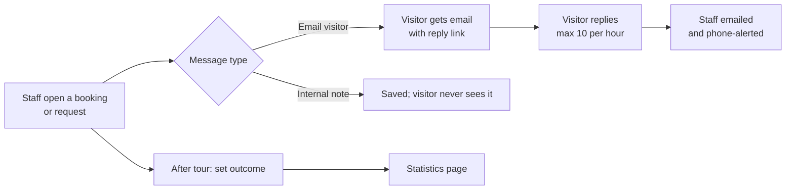

---

## W-10 Tour notifications and reminders

**Business purpose:** Make sure the right people hear about tour events without anyone having to watch the admin screen.

**Participants:** Tours staff, system.

**Normal process:**
1. Four tour events can notify people: **booked**, **walk-up created**, **walk-up taken**, **walk-up still untaken**.
2. For each, staff choose which email addresses (up to 50) get an email, and which staff members' personal phone-alert topics are linked.
3. The "untaken" alert fires **once per request** after a configured number of days (default 3) and is checked every 30 minutes.
4. Every minute the system writes timeline reminders for upcoming tours ("due now", "in 1 / 3 / 6 hours"), once each, only within 30 minutes of the moment.

**Failure scenarios:** A failed notice never blocks the booking; it is logged and skipped.

**Business rules:** [BR-E18 – BR-E20](BUSINESS_RULES.md#e-tours).

**Result:** Notified staff; timeline entries.

**Implementation evidence:** `lib/tours-notify.ts`, `lib/ntfy.ts` (`TOUR_EVENTS`), `lib/tours.ts` (`checkReminders`, `checkStale`), `instrumentation.ts`.

**Open questions:** Reminders are written only to the internal timeline. The guide and visitor are **not** sent a reminder email 🔶 ([G-13](PROCESS_GAPS.md#g-13)).

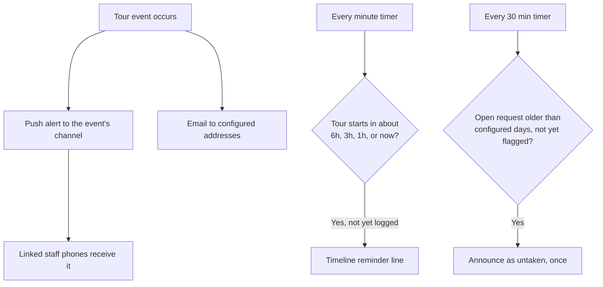

---

## W-11 Class scheduling and sign-up

**Business purpose:** Publish classes and let approved members reserve seats fairly.

**Participants:** CRM staff, approved member.

**Normal process:**
1. Staff create a class: title, description, start/end, location, instructor, capacity (0 = unlimited), price (free text), level, prerequisites, materials, poster image.
2. Members see upcoming classes and sign up (or cancel).
3. The first *capacity* sign-ups, in order of sign-up time, are **confirmed**; later ones are on the **waitlist**. When someone cancels, the next waitlisted person is automatically promoted (no message is sent).
4. Staff see a roster in sign-up order.

**Failure scenarios:** Sign-up refused if the class is cancelled or has started. Already signed up → no duplicate.

**Business rules:** [BR-F1 – BR-F4](BUSINESS_RULES.md#f-classes).

**Result:** Roster; members see "confirmed" or "waitlist".

**Implementation evidence:** `lib/crm.ts` (`saveClass`, `signUp`, `cancelSignUp`, `roster`, `upcomingClasses`), `app/members/classes/page.tsx`.

**Open questions:** No notification when a waitlisted member is promoted, nor when a class is cancelled or changed ([G-05](PROCESS_GAPS.md#g-05), [G-06](PROCESS_GAPS.md#g-06)). No payment is collected.

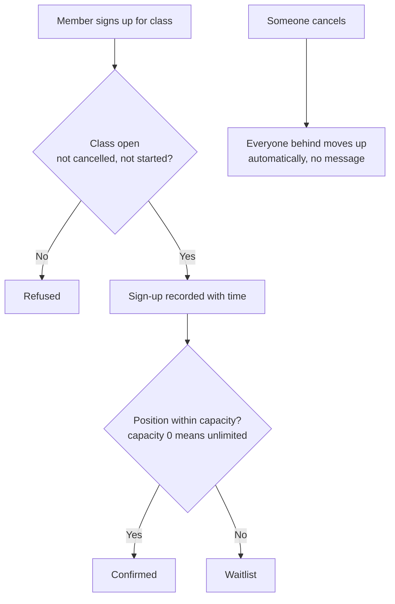

---

## W-12 Class proposal and approval

**Business purpose:** Let members teach, with staff controlling quality and lead time.

**Participants:** Member (proposer), CRM staff, all approved members (announcement).

**Normal process:**
1. A member proposes a class with title, description (at least 40 characters), date, level, duration, capacity, price, materials, prerequisites, optional poster. The date must be **at least 45 days ahead** (staff can raise this number, never lower it).
2. A member may have at most **3 proposals pending**. All CRM staff and administrators are notified.
3. Staff review and either **approve** (may adjust title, description, date/time, location, capacity, price) or **decline** (a reason is **required**).
4. On approval, the class is created with the proposer as instructor, the proposer is notified, and staff may tick a box to **email every approved member** a one-time-link teaser ("Reserve my spot," link valid 90 days).
5. The proposer can withdraw a proposal while it is pending.

**Failure scenarios:** Date too soon, description too short, 3 already waiting → refused. Approving with the email box ticked but email not set up → **nothing is approved** (so staff can fix mail or untick the box). Already decided → refused.

**Business rules:** [BR-F5 – BR-F9](BUSINESS_RULES.md#f-classes).

**Result:** An approved class on the calendar and optionally an announcement; or a decline with reason.

**Implementation evidence:** `lib/crm.ts` (`proposeClass`, `decideProposal`, `announceClass`, `classMinDays`), `lib/rules.ts` (`MIN_CLASS_DAYS`), `app/api/members/art/route.ts`.

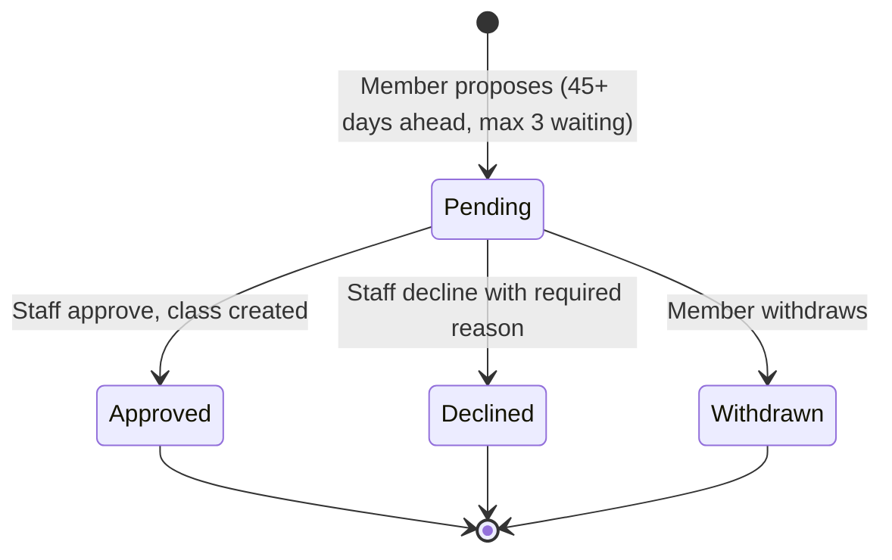

---

## W-13 Membership levels and tool sign-offs

**Business purpose:** Record what plan a member holds and which tools they are cleared to use.

**Participants:** CRM staff; the member (view only).

**Normal process:**
1. Staff open a person's CRM page and tick the **membership levels** they hold. Levels must match a plan on the public Pricing page (a level that has since left that page can be kept or removed).
2. Staff **grant a tool authorization** (optionally with an expiry date and note) or **revoke** it.
3. The member sees both on their home page; expired sign-offs are flagged ("ask at the space about a refresher").

**Failure scenarios:** A level not on the Pricing page is refused. Unknown tool/member is refused.

**Business rules:** [BR-G1 – BR-G3](BUSINESS_RULES.md#g-memberships-and-tools).

**Result:** Recorded levels and sign-offs, with an audit entry.

**Implementation evidence:** `lib/crm.ts` (`setMemberships`, `grantAuth`, `revokeAuth`), `app/members/page.tsx`.

**Open questions:** Levels do not expire and carry no payment status; sign-offs expire on paper but nothing enforces or notifies ([G-01](PROCESS_GAPS.md#g-01), [G-14](PROCESS_GAPS.md#g-14)).

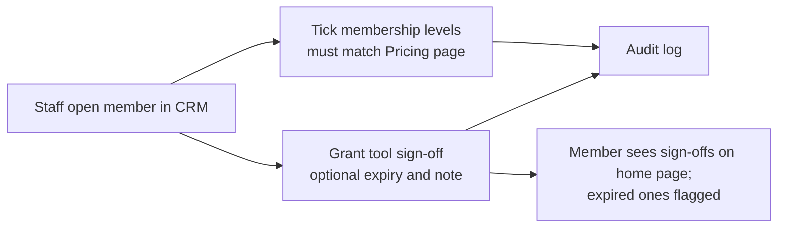

---

## W-14 Member directory and messaging

**Business purpose:** Help members find others with skills while keeping contact details private.

**Participants:** Members.

**Normal process:**
1. A member **opts in** to the directory on their profile and chooses what to show: bio, up to 20 skills (learning / competent / can teach), profile facts (occupation, company, city…), optionally their phone, email, Discord, social links. Name shown as first name + last initial.
2. Members search by name, skill, level and profile facts.
3. To contact someone, a member writes through the site: the message lands in the recipient's in-app inbox and is also emailed to them with a one-time sign-in link to the conversation. The sender's email is never revealed.
4. **Both** people must be in the directory.

**Business rules:** First contact is limited to **2 per day per recipient** and **5 per hour overall**; once the other person has written first, 30/hour and 30/day. Messages must be at least 5 characters and at most 2000.

**Failure scenarios:** Sender or recipient not opted in; rate limits; messaging yourself.

**Implementation evidence:** `lib/crm.ts` (`setMySkills`, `searchDirectory`, `messageMember`, `conversations`, `thread`), `app/members/directory/page.tsx`, `app/members/inbox/**`.

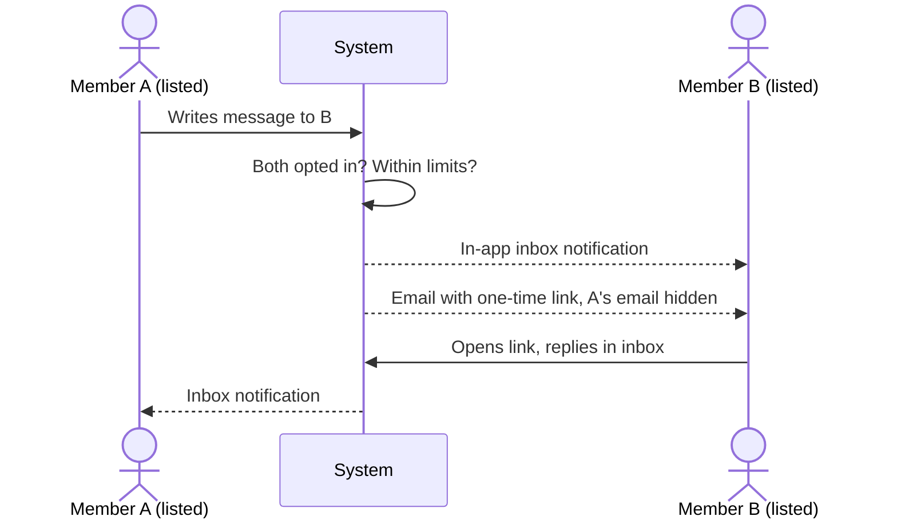

---

## W-15 Volunteer chores and time tracking

**Business purpose:** Keep recurring upkeep visible (what is due, who did it last) and recognize the hours volunteers give.

**Participants:** Members, staff with chores access, the outside "YAMNet" system (via API key).

**Normal process:**
1. Staff define **chores**: name, nicknames (used to match spoken names), how often (1–366 days, or "as needed"), notes. Chores can be *snoozed* for 1–366 days or retired (hours already given stay counted).
2. A chore is **due** when the last completion plus its interval arrives; the list shows overdue days, who last did it, who is on it now.
3. A member **starts** a shift, then **finishes** it (or logs time already done, up to 16 hours, not in the future).
4. Hours totals by period (today, week, month, year, all time), statistics and **achievements** (staff-defined goals, e.g. "times done," "hours," "on-time visits," earned automatically from the log) are shown to everyone.
5. The outside system uses a **scoped key** to read chores/hours or start/finish/log time for a member, and to match a spoken name to a member.

**Failure scenarios:** Starting a chore you already have open is refused. A shift left open **over 12 hours** cannot be finished without saying how many minutes it took. A member can only finish **their own** shifts. Only approved, active members can have time logged.

**Business rules:** [BR-H1 – BR-H7](BUSINESS_RULES.md#h-volunteer-chores).

**Result:** A time log, hours totals, due dates, achievements.

**Implementation evidence:** `lib/chores.ts`, `lib/chores-calc.ts`, `lib/api-keys.ts`, `app/api/chores/route.ts`, `app/api/members/chores/route.ts`, `app/api/webmaster/chores/route.ts`.

**Open questions:** Staff can delete log entries; every member action is recorded in the audit log, but there is no approval step for logged hours 🔶 ([G-15](PROCESS_GAPS.md#g-15)).

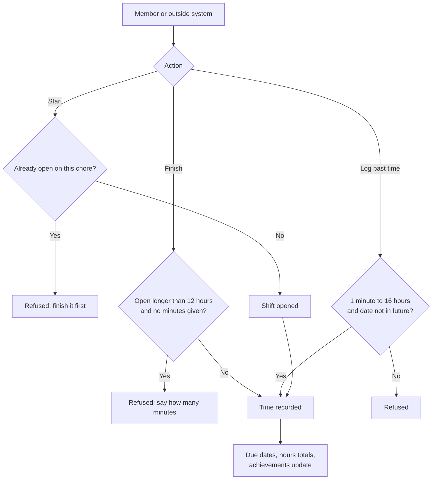

---

## W-16 Contact form and spam holding

**Business purpose:** Receive messages from the public for the office and the board without being buried in spam, and without telling spammers they were caught.

**Participants:** Visitor, administrators, system.

**Normal process:**
1. The visitor submits name, email, optional subject and a message (10–3000 characters) on the Contact or Board contact form.
2. Limits: 5 per hour per network and 30 per hour overall.
3. The text is screened. Clean messages are emailed at once to **contact@** or **board@**, with the visitor's address set as Reply-To.
4. Anything suspicious (duplicate within a day, Cyrillic text, four or more links, or repeated characters) is saved as **Held**. The visitor still sees a normal "thanks" screen.
5. An administrator reviews held messages: **approve** (emails it now), **reject** (kept for the record), **restore**, or delete.

**Failure scenarios:** If emailing fails, the message is saved as Held with the reason so nothing is lost. Approving a message that was already sent does nothing.

**Business rules:** [BR-I1 – BR-I3](BUSINESS_RULES.md#i-communications).

**Implementation evidence:** `lib/contact.ts`, `lib/spam.ts`, `app/api/contact/route.ts`, `app/admin/forms/page.tsx`.

**Open questions:** A genuine message wrongly held gets no feedback to the sender and waits for an admin ([G-04](PROCESS_GAPS.md#g-04)).

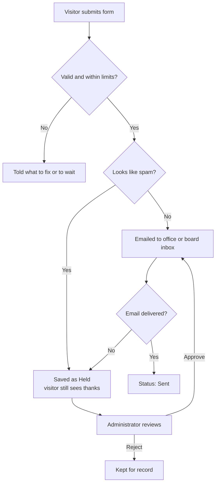

---

## W-17 Newsletter subscription and campaigns

**Business purpose:** Build consented mailing lists and send email to them, respecting unsubscribes and bounces.

**Participants:** Subscriber, mail staff, system.

**Normal process (subscribing):**
1. A visitor submits an enabled signup form (a hidden decoy field catches bots; 5 tries per 10 minutes per network).
2. With **double opt-in** on (and email set up), they are sent a confirmation link and stay *unconfirmed* until clicking. With it off, they are subscribed immediately.
3. A welcome email is sent the first time someone becomes subscribed.
4. Consent time, source and network address are recorded.

**Normal process (sending):**
1. Staff compose an email (blocks editor, templates, optional AI draft), pick lists and optional tags, and send a test.
2. **Send now** or **schedule** (at least one minute ahead).
3. The system builds the recipient list (subscribed people only), then delivers in order, tracking opens and clicks with signed links. State is saved per recipient, so a restart resumes where it left off. A per-minute sending cap can be configured.
4. Each email carries an unsubscribe link and a preferences page.

**Alternative paths:** Approved applicants join "Registered users"; people finishing onboarding join "Members"; members can opt in to handbook updates (W-18). Staff can import, bulk-edit, export, or erase a person (privacy request).

**Failure scenarios:** Hard bounces and spam complaints (reported by the mail provider) permanently stop mail to that address; they can never be re-subscribed by a stray link. A send needs a subject, at least one list, non-empty content and at least one subscriber.

**Business rules:** [BR-I4 – BR-I8](BUSINESS_RULES.md#i-communications).

**Implementation evidence:** `lib/mail.ts` (`publicSubscribe`, `tokenAction`, `sendCampaign`, `work`, `tick`, `handleWebhook`), `app/api/subscribe/route.ts`, `app/mail/[action]/route.ts`.

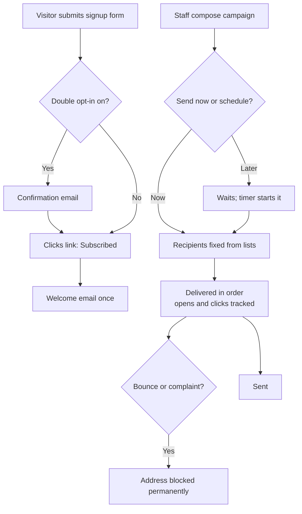

---

## W-18 Handbook change announcement

**Business purpose:** Tell members who asked for it when the handbook changes, with a plain-language summary.

**Participants:** Webmaster staff (handbook editors), opted-in subscribers, system.

**Normal process:**
1. Any save of the handbook is compared with the previous version. Edits pile up in one open "pending update"; editing back to the original discards it.
2. Staff open **Handbook updates**, see the exact changes, optionally generate an AI plain-language summary (they edit it), and choose whether to include the exact wording changes.
3. Staff **send**: an ordinary email campaign goes to the "Request Handbook Updates" list (visible with stats under Email), or **skip**.
4. Members opt in or out themselves from the handbook page.

**Failure scenarios:** Nothing changed, nobody subscribed, or already sent/skipped → refused. If sending fails, the update returns to pending.

**Business rules:** [BR-I9](BUSINESS_RULES.md#i-communications).

**Implementation evidence:** `lib/handbook.ts`, `app/api/handbook/updates/route.ts`, `app/api/webmaster/handbook/route.ts`.

**Open questions:** Announcements are optional; a handbook change is **not** tied to re-acknowledgement the way the agreement is ([G-16](PROCESS_GAPS.md#g-16)).

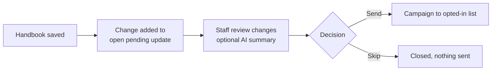

---

## W-19 Board document e-signing

**Business purpose:** Gather traceable signatures on board papers (resolutions, minutes, contracts) without printing.

**Participants:** Board-papers staff (creator), signers/approvers/viewers/copy recipients (outside people allowed), system.

**Starting event:** Staff create a paper (typed text or an uploaded PDF up to 8 MB / 200 pages).

**Normal process:**
1. Staff choose title, optional bucket (folder) and tags, people present, due date, a message, and the list of recipients with a **role**: *signer* or *approver* (must act), *viewer* (confirms reading), *cc* (gets the final copy). For PDFs, signature fields (also initials, date, name, email, text, checkbox, dropdown) are placed per person.
2. Options: signing in order or all at once; "only N of the signers are needed"; optional per-person password and/or emailed 6-digit code; hide the audit page; redirect link after signing.
3. Each recipient is emailed a **personal link**. Opening it is recorded.
4. Each person completes and signs (typed name, optional drawn signature, fields).
5. When enough have signed, the paper becomes **Complete**: the system builds the final PDF with a signing-audit page, digitally seals it if a certificate is configured, stores it **encrypted**, and emails it to everyone who signed, all *cc* people and the creator.

**Alternative paths:** Staff can *remind* waiting signers, *copy* a link instead of emailing it, change the due date, or **void** an open paper. Templates can be saved, and a template can have a **public link** for a visitor to start their own copy.

**Failure scenarios:**
- Wrong password/code: 10 wrong tries lock the link until a new one is issued; codes expire after 10 minutes.
- Overdue papers become **Expired** the next time they are viewed or listed; extending the due date reopens them.
- A signer who **declines** is recorded with their reason, but the paper stays open ([G-07](PROCESS_GAPS.md#g-07)).
- Anyone who already responded cannot respond again.

**Business rules:** [BR-J1 – BR-J8](BUSINESS_RULES.md#j-governance-documents).

**Result:** A signed, sealed, encrypted PDF delivered to participants; audit entries.

**Implementation evidence:** `lib/sign.ts`, `lib/sign-pdf.ts`, `lib/pdf-seal.ts`, `lib/sign-access.ts`, `app/sign/[token]/page.tsx`, `app/api/sign/route.ts`, `app/api/webmaster/signed-docs/route.ts`.

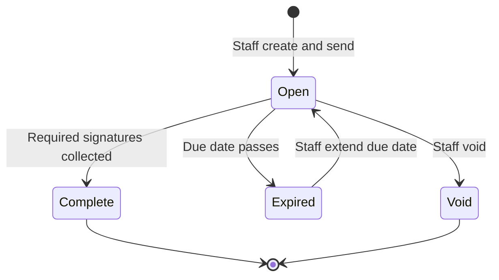

```mermaid
sequenceDiagram
    actor Staff as Board-papers staff
    participant S as System
    actor P as Signer
    Staff->>S: Create paper, add people and fields
    S->>P: Email personal link
    P->>S: Opens link (recorded)
    opt Password or code required
        S->>P: Emailed 6-digit code (10 min)
        P->>S: Enters password and code
    end
    P->>S: Signs
    S->>S: All needed signatures?
    alt Not yet
        S->>P: Next person emailed if signing in order
    else Complete
        S->>S: Build, seal and encrypt final PDF
        S->>Staff: Signed copy emailed
        S->>P: Signed copy emailed
    end
```

---

## W-20 Blog publishing and comment moderation

**Business purpose:** Publish news and manage reader conversation safely.

**Participants:** Blog staff, signed-in readers (any verified account that has not been rejected), post authors.

**Normal process (publishing):**
1. Staff write a post (title, excerpt, body, image, tags, categories, author), save as **draft** or **published**, optionally with a future **publish time**. A post is live when it is published and its time has passed. Each save is a restorable revision.
2. Staff manage authors, categories and the media library.

**Normal process (comments):**
1. A signed-in reader submits a comment (up to 2000 characters), optionally as a reply.
2. Limits: one per 10 seconds per person, 5 per 10 minutes per network.
3. The text is screened: duplicates, blocked words and Cyrillic or 4+ links go straight to **spam**; a link from a first-timer, mostly capitals, or repeated characters is **held**. Otherwise the site's moderation mode applies: *none* (all approved), *first-time* (default: first comment held), or *all* held.
4. Readers see approved comments plus their own pending ones. Spam is shown to its author as "pending" so bots cannot tell.
5. Approved comments notify the post's author and the person replied to (in-app and by email).
6. Staff approve, hide, mark as spam, delete (replies go too) or empty the spam folder. Comments can be closed after N days.

**Business rules:** [BR-K1 – BR-K5](BUSINESS_RULES.md#k-blog-reviews-and-website).

**Implementation evidence:** `lib/blog.ts`, `lib/comments.ts`, `lib/spam.ts`, `app/api/blog/comments/route.ts`, `app/api/webmaster/comments/route.ts`.

```mermaid
flowchart TD
    A["Reader submits comment"] --> B{"Signed in, within limits,<br/>post open for comments?"}
    B -->|"No"| B1["Refused with reason"]
    B -->|"Yes"| C{"Spam rules"}
    C -->|"Hard spam"| D["Stored as spam<br/>author sees pending"]
    C -->|"Suspicious"| E["Held for review"]
    C -->|"Clean"| F{"Moderation mode"}
    F -->|"None"| G["Approved"]
    F -->|"First-time"| H{"Has prior approved comment?"}
    H -->|"Yes"| G
    H -->|"No"| E
    F -->|"All"| E
    E --> I["Staff approve or hide"]
    I --> G
    G --> J["Author and parent commenter notified"]
```

---

## W-21 Member review to homepage

**Business purpose:** Showcase genuine member testimonials after staff approval.

**Participants:** Approved member, webmaster staff.

**Normal process:**
1. An approved member submits a review (10–800 characters), role/title, and optional photo (resized to a 240-pixel square).
2. Limits: one waiting at a time; 3 per day.
3. The text goes through the spam filter in "hold everything" mode; obvious spam is stored as *rejected* but the member is told thanks.
4. Webmaster staff edit name, role and text if needed, and **approve**: the review is added to the homepage roster (once). They can reject, restore, or delete (an approved review's photo stays as it is still used by the homepage).

**Business rules:** [BR-K6 – BR-K7](BUSINESS_RULES.md#k-blog-reviews-and-website).

**Implementation evidence:** `lib/reviews.ts`, `app/api/reviews/route.ts`, `app/api/webmaster/reviews/route.ts`.

```mermaid
flowchart LR
    A["Member submits review"] --> B{"One already waiting<br/>or 3 today?"}
    B -->|"Yes"| B1["Refused"]
    B -->|"No"| C{"Spam filter"}
    C -->|"Spam"| D["Stored as rejected<br/>member sees thanks"]
    C -->|"OK"| E["Pending"]
    E --> F["Staff edit and approve"]
    F --> G["Added to homepage"]
    E --> H["Staff reject"]
```

---

## W-22 Website content editing, history and undo

**Business purpose:** Let non-programmers keep the website accurate and undo mistakes.

**Participants:** Webmaster staff (and others by section), public readers.

**Normal process:**
1. Content is edited in the browser: free-form pages in a visual editor; "guided" pages (homepage, about, pricing, team, handbook, shops, contact…) through forms; plus menu, hours and address, board of directors, calendar link, robots rules, privacy policy.
2. Each save is recorded (who, when, before/after). Saves identical to the current content are ignored.
3. Staff can browse the **audit log**, see what changed, and **revert** (where a "before" exists). Deleted pages can be restored with their menu links.
4. **Financial reports:** staff upload one PDF per year (max 10 MB, must be a real PDF), which appears at a public link and adds "Financials" to the public menu once a PDF exists. Replacing keeps the first upload date.
5. Link clicks leaving the site, referrers and traffic are counted for staff.

**Business rules:** [BR-K8 – BR-K12](BUSINESS_RULES.md#k-blog-reviews-and-website).

**Implementation evidence:** `lib/store.ts`, `lib/guided.ts`, `lib/financials.ts`, `app/api/pages/route.ts`, `app/api/webmaster/**`.

**Open questions:** The page layouts of the core "locked" pages are re-loaded from files in the repository at every server start (by design, per the README); content edited through the guided forms is stored separately and is not overwritten 🔶. Whether the layouts themselves should ever be editable in the browser is a product decision.

```mermaid
flowchart TD
    A["Staff edit and save"] --> B{"Different from<br/>current content?"}
    B -->|"No"| B1["Nothing recorded"]
    B -->|"Yes"| C["Saved; revision and audit entry written"]
    C --> D["Public site updates"]
    E["Mistake noticed"] --> F["Open history or audit log"]
    F --> G{"Earlier version available?"}
    G -->|"Yes"| H["Revert; new audit entry"]
    G -->|"No"| I["Cannot revert"]
```

---

## W-23 Monitoring and data retention

**Business purpose:** Let administrators see the health and activity of the system, and prevent old data from accumulating forever.

**Participants:** Administrators, system.

**Normal process:**
1. Administrators can view: the audit log, a log of web requests (with response codes), database health, link-click and referrer statistics, a debug view, and phone-alert (ntfy) topics, tokens and connected devices.
2. Admins configure: upload size limits, web-security headers, privacy policy text, AI model choices, a signing certificate, API keys (shown once; only a fingerprint is stored; optional expiry), and sign-up rate reset.
3. Every 6 hours, data older than **5 years** is deleted from: audit log, page revisions, tour timeline, email click records, contact messages, notifications; sent email campaigns older than 5 years are deleted with their recipients and clicks.
4. Link-click *details* are kept 180 days (daily totals forever).

**Business rules:** [BR-L1 – BR-L3](BUSINESS_RULES.md#l-operations-and-retention).

**Open questions:** Member records, signed agreements, ID images, approval threads, chore logs and class data are **not** covered by any cleanup ([G-08](PROCESS_GAPS.md#g-08)).

**Implementation evidence:** `lib/retention.ts`, `instrumentation.ts`, `lib/links.ts`, `lib/api-keys.ts`, `lib/httplog.ts`, `app/admin/services/**`.

```mermaid
flowchart LR
    T["Every 6 hours"] --> P{"Row older than 5 years?"}
    P -->|"Audit, page history, tour timeline,<br/>email clicks, contact messages,<br/>notifications, sent campaigns"| D["Deleted"]
    P -->|"Anything else"| K["Kept indefinitely"]
```
